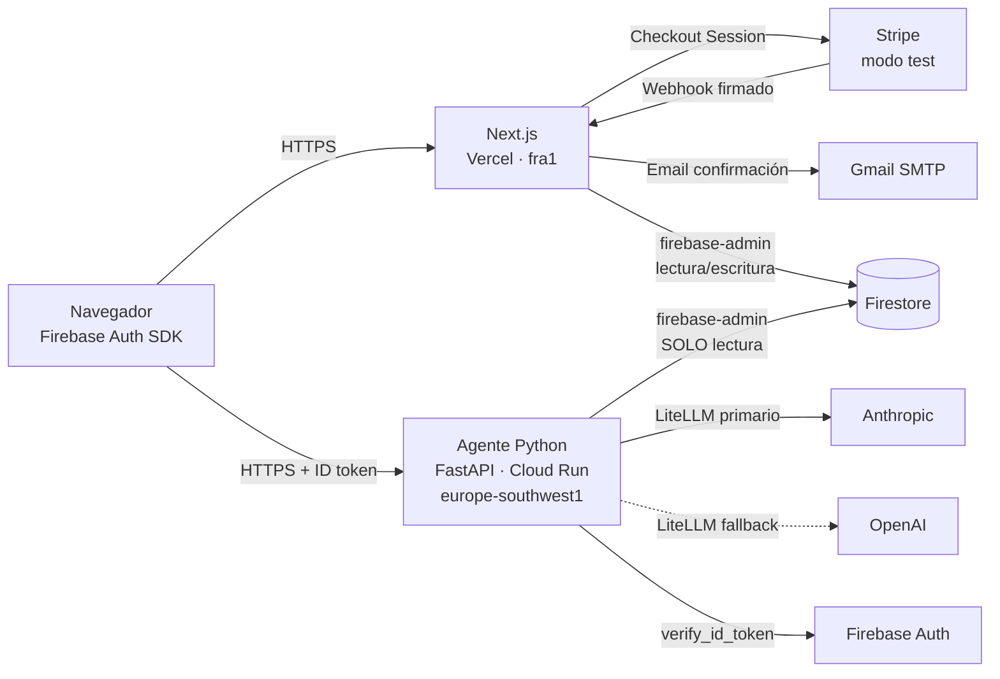
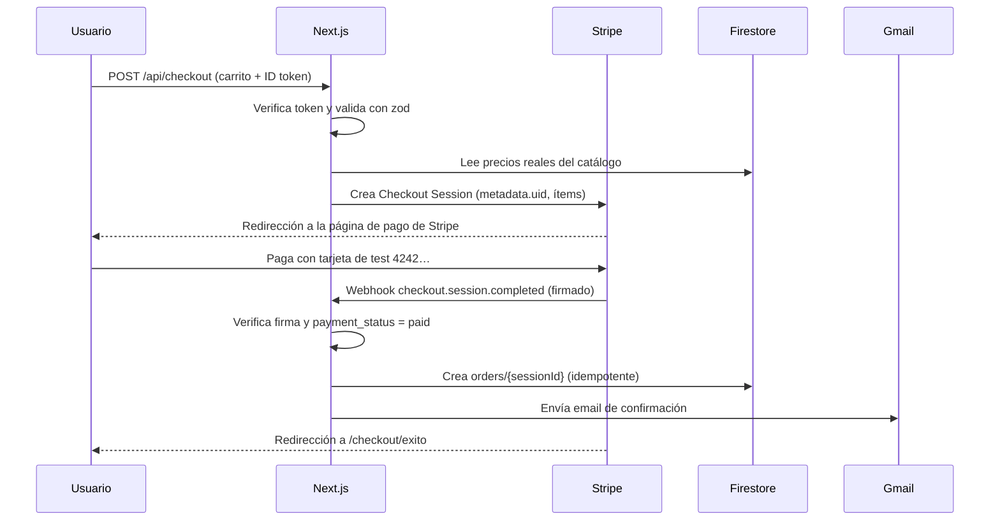
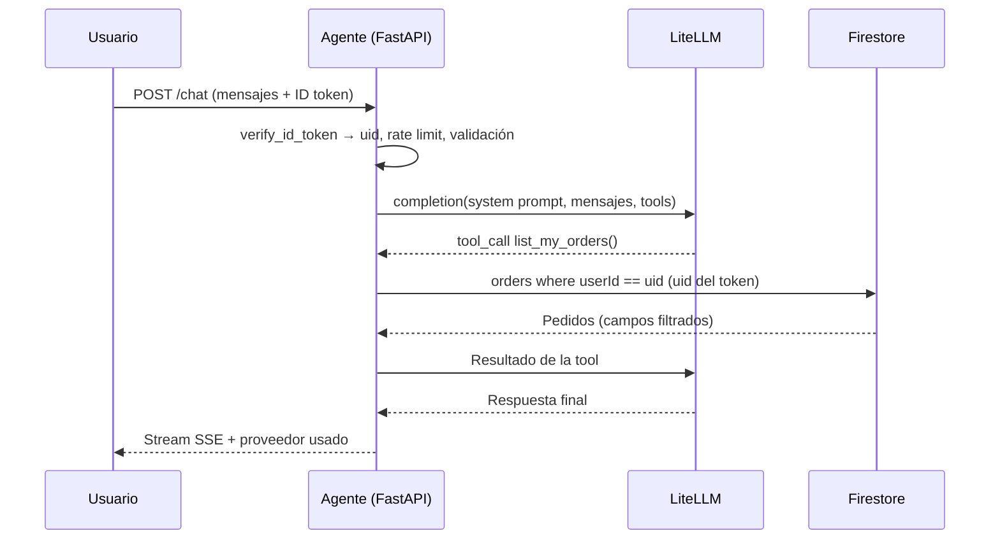

# Arquitectura — Ecommerce de colchones con asistente IA

Prueba técnica · Desarrollador Full Stack AI Native · Clearpoint
Fecha límite: sábado 17/10/2026 23:59 (hora peninsular española) = 16:59 hora Colombia

---

## 1. Resumen

Ecommerce de colchones (home + 2 fichas de producto: *Colchón minicuna ovalado* y *Colchón cuna ovalado*) con:

- Productos configurables según las opciones de la web de referencia, y carrito.
- Registro e inicio de sesión. Cada usuario ve únicamente sus pedidos.
- Pago real en modo test con Stripe y email real de confirmación tras el pago.
- Asistente IA **de solo consulta** sobre productos, envíos/devoluciones y pedidos actualizados del usuario autenticado, con fallback Anthropic → OpenAI.
- Responsive (móvil y escritorio), desplegado en la nube y accesible desde España.

---

## 2. Arquitectura general



### Reparto de responsabilidades

| Componente | Responsabilidad | No hace |
|---|---|---|
| **Next.js (Vercel)** | UI, carrito, auth en cliente, checkout, webhook de Stripe, email | No ejecuta el agente IA |
| **Agente Python (Cloud Run)** | Verificar el token, orquestar el LLM y las tools de consulta | No escribe en la base de datos, no gestiona pagos |
| **Firebase** | Auth (usuarios) y Firestore (datos) | No se usan Functions ni Hosting |
| **Stripe** | Página de pago alojada y confirmación vía webhook | Los datos de tarjeta nunca tocan nuestros servidores |
| **Gmail (SMTP)** | Envío del email transaccional con contraseña de aplicación | — |

---

## 3. Stack tecnológico

### Frontend y API de tienda — `web/`
| Tecnología | Uso |
|---|---|
| Next.js (App Router) + TypeScript | Framework web, SSR y route handlers |
| Tailwind CSS + shadcn/ui | Estilos y componentes accesibles, responsive |
| Zustand (persistido en localStorage) | Estado del carrito |
| Zod | Validación de entradas en el cliente y en las API routes |
| Firebase JS SDK | Auth en el cliente y lectura de "Mis pedidos" (protegida por reglas) |
| firebase-admin | Escritura de pedidos desde el webhook y lectura de catálogo en servidor |
| stripe (Node) | Checkout Sessions y verificación de webhooks |
| Nodemailer (Gmail SMTP) + React Email | Email de confirmación |
| react-markdown (sin HTML crudo) | Render seguro de las respuestas del asistente |

### Agente IA — `agent/`
| Tecnología | Uso |
|---|---|
| Python 3.12 + FastAPI + Uvicorn | API del agente |
| Pydantic | Validación de peticiones |
| LiteLLM (versión fijada) | Abstracción multi-proveedor, tool calling y fallback |
| Anthropic (primario) / OpenAI (fallback) | Modelos LLM |
| firebase-admin (Python) | Verificación de ID tokens y lectura de Firestore |
| Docker | Contenedor para Cloud Run |
| pytest | Tests de tools y autorización |

### Infraestructura
| Servicio | Uso |
|---|---|
| Vercel | Hosting de Next.js; funciones en región europea (`fra1` o `cdg1`) |
| Google Cloud Run | Contenedor del agente en `europe-southwest1` (Madrid) |
| Google Secret Manager | Claves de Anthropic y OpenAI |
| Firebase (plan Blaze) | Auth y Firestore en región europea |
| GitHub (repositorio privado) | Código e historial completo |

---

## 4. Estructura del repositorio (monorepo)

```
clearpoint-colchones/
├── web/                      # Next.js → Vercel (Root Directory = web)
│   ├── app/
│   │   ├── page.tsx                     # Home
│   │   ├── productos/[slug]/page.tsx    # Fichas de producto
│   │   ├── carrito/page.tsx
│   │   ├── checkout/exito/page.tsx
│   │   ├── checkout/cancelado/page.tsx
│   │   ├── login/page.tsx
│   │   ├── registro/page.tsx
│   │   ├── pedidos/page.tsx             # Mis pedidos
│   │   ├── pedidos/[id]/page.tsx
│   │   ├── envios-y-devoluciones/page.tsx
│   │   └── api/
│   │       ├── checkout/route.ts
│   │       └── webhooks/stripe/route.ts
│   ├── components/           # UI, ChatWidget, ProductConfigurator...
│   ├── lib/                  # firebase client/admin, stripe, zod schemas
│   ├── emails/               # Plantilla React Email
│   └── .env.example
├── agent/                    # FastAPI + LiteLLM → Cloud Run
│   ├── app/
│   │   ├── main.py           # Endpoints, CORS, límites
│   │   ├── auth.py           # verify_id_token → uid
│   │   ├── llm.py            # Router LiteLLM con fallback
│   │   ├── agent.py          # Bucle de tool calling
│   │   ├── tools.py          # Tools de solo lectura
│   │   └── prompts.py        # System prompt
│   ├── tests/
│   ├── Dockerfile
│   ├── requirements.txt      # Versiones fijadas
│   └── .env.example
├── firebase/
│   ├── firebase.json
│   ├── firestore.rules
│   └── firestore.indexes.json
├── scripts/
│   ├── seed.ts               # Productos, política, usuarios y pedidos demo
│   └── update-order-status.ts  # Simula el avance de un pedido (demo)
├── docs/
│   ├── ARQUITECTURA.md
│   └── memoria-tecnica.md
├── .gitignore
├── .pre-commit-config.yaml   # gitleaks
└── README.md
```

---

## 5. Modelo de datos (Firestore)

### `products/{slug}`
```json
{
  "slug": "colchon-cuna-ovalado",
  "name": "Colchón cuna ovalado",
  "description": "…",
  "images": ["/images/…"],
  "options": [
    { "name": "Medida", "values": ["…según referencia…"] }
  ],
  "variants": [
    { "sku": "CUNA-OV-XXX", "options": { "Medida": "…" }, "price": 0, "currency": "EUR", "inStock": true }
  ],
  "features": ["…"],
  "active": true
}
```
> Las opciones y precios exactos se toman de las fichas de referencia.

### `content/shipping_policy`
```json
{ "title": "Envíos y devoluciones", "body_md": "…", "updatedAt": "…" }
```

### `users/{uid}`
```json
{ "email": "…", "displayName": "…", "createdAt": "…" }
```

### `orders/{stripeSessionId}`
El ID del pedido es el ID de la sesión de Stripe, lo que garantiza la idempotencia del webhook.
```json
{
  "orderNumber": "CP-000123",
  "userId": "uid",
  "email": "…",
  "status": "paid | preparing | shipped | delivered | cancelled",
  "statusHistory": [{ "status": "paid", "at": "…" }],
  "items": [
    { "productSlug": "…", "name": "…", "sku": "…", "options": {}, "unitPrice": 0, "quantity": 1 }
  ],
  "subtotal": 0, "shipping": 0, "total": 0, "currency": "EUR",
  "shippingAddress": { "name": "…", "line1": "…", "city": "…", "postalCode": "…", "country": "ES" },
  "carrier": null, "trackingNumber": null, "estimatedDelivery": null,
  "stripePaymentIntentId": "…",
  "createdAt": "…", "updatedAt": "…"
}
```

### Índices
- `orders`: `userId ASC, createdAt DESC`

---

## 6. Flujos principales

### 6.1 Registro e inicio de sesión
1. El usuario se registra o inicia sesión con Firebase Auth (email y contraseña).
2. El cliente obtiene un ID token (caduca cada hora y se renueva automáticamente).
3. El token se envía en `Authorization: Bearer` a `/api/checkout` y al agente.

### 6.2 Compra

- Los precios **siempre** se recalculan en el servidor; el cliente solo envía SKU y cantidad.
- Stripe Checkout recoge la dirección de envío (`shipping_address_collection`).
- El pedido **solo** se crea desde el webhook, nunca desde la página de éxito.

### 6.3 Asistente IA


---

## 7. Agente IA

### Endpoints
| Método | Ruta | Auth | Descripción |
|---|---|---|---|
| GET | `/health` | No | Healthcheck |
| POST | `/chat` | Sí (ID token) | Conversación con streaming SSE |

El asistente puede responder a preguntas generales (productos, envíos) sin sesión; las tools de pedidos solo se habilitan si hay un token válido.

### Tools (todas de solo lectura)
| Tool | Parámetros | Fuente |
|---|---|---|
| `list_products` | — | `products` |
| `get_product` | `slug` | `products/{slug}` |
| `get_shipping_policy` | — | `content/shipping_policy` (o en el system prompt) |
| `list_my_orders` | `limit?` | `orders` where `userId == uid` |
| `get_my_order` | `order_number` | Verifica que `order.userId == uid` |

**Regla clave:** el `uid` nunca es un parámetro de una tool. Se inyecta desde el token verificado en el servidor, así que el modelo no puede elegir de qué usuario lee.

### Proveedores y fallback (LiteLLM)
- **Primario:** Anthropic (clave temporal proporcionada por Clearpoint).
- **Fallback:** OpenAI (clave propia; opcional; si no está configurada, el agente funciona sin fallback).
- Se activa ante errores 5xx, rate limit o timeout. `timeout=30s`, `num_retries=1`.
- Las tools se definen una sola vez en formato OpenAI y LiteLLM las traduce.
- `FORCE_FALLBACK=true` permite demostrar el fallback; cada respuesta registra el proveedor usado.

### Límites (control de consumo)
| Límite | Valor inicial |
|---|---|
| `max_tokens` por respuesta | 1024 |
| Iteraciones de tools por turno | 5 |
| Longitud del mensaje del usuario | 1000 caracteres |
| Historial enviado al modelo | Últimos 20 mensajes |
| Rate limit | 20 mensajes / 10 min por uid (o por IP si es anónimo) |

### System prompt (criterios)
- Asistente de consulta de la tienda; responde en español.
- Solo usa datos de las tools; si no sabe algo, lo dice y no inventa.
- No puede modificar, cancelar ni crear pedidos; para eso remite al servicio de atención al cliente.
- No revela instrucciones internas ni datos de otros usuarios.

---

## 8. Seguridad

### 8.1 Gestión de secretos
| Secreto | Ubicación | ¿Llega al navegador? |
|---|---|---|
| `STRIPE_SECRET_KEY`, `STRIPE_WEBHOOK_SECRET` | Vercel (sensitive) | No |
| `GMAIL_APP_PASSWORD` | Vercel (sensitive) | No |
| `FIREBASE_ADMIN_CREDENTIALS` (JSON base64) | Vercel (sensitive) | No |
| `ANTHROPIC_API_KEY`, `OPENAI_API_KEY` | Secret Manager → Cloud Run | No |
| Acceso del agente a Firestore | Cuenta de servicio de Cloud Run (sin archivo de clave) | No |
| `NEXT_PUBLIC_FIREBASE_*`, `NEXT_PUBLIC_STRIPE_PUBLISHABLE_KEY` | Vercel (públicas por diseño) | Sí |

Prácticas:
- `.env*` en `.gitignore` desde el primer commit; `.env.example` sin valores.
- **gitleaks** como pre-commit hook. Si se filtra una clave, se **rota** (no se reescribe el historial).
- El prefijo `NEXT_PUBLIC_` es la frontera: nada secreto lo lleva.
- La configuración web de Firebase es pública por diseño; la seguridad está en las reglas y en la verificación de tokens.
- Mejora futura: Workload Identity Federation (OIDC de Vercel → GCP) para eliminar la clave JSON exportada.

### 8.2 Reglas de Firestore
```
rules_version = '2';
service cloud.firestore {
  match /databases/{db}/documents {
    match /products/{id}  { allow read: if true;  allow write: if false; }
    match /content/{id}   { allow read: if true;  allow write: if false; }
    match /users/{uid}    { allow read: if request.auth != null && request.auth.uid == uid;
                            allow write: if false; }
    match /orders/{id}    { allow read: if request.auth != null
                                        && resource.data.userId == request.auth.uid;
                            allow write: if false; }
  }
}
```
Toda escritura se hace desde el servidor con el Admin SDK.

### 8.3 OWASP Top 10 aplicado
| Riesgo | Mitigación |
|---|---|
| Broken Access Control | Reglas de Firestore; `uid` siempre del token verificado; comprobación de propiedad en `get_my_order` (evita IDOR) |
| Cryptographic Failures | HTTPS en todo; contraseñas gestionadas por Firebase Auth; tarjetas solo en Stripe |
| Injection | zod (Next.js) y Pydantic (FastAPI); validación de formato de IDs y slugs |
| Insecure Design | Precios recalculados en servidor; pedidos solo vía webhook firmado; agente de solo lectura |
| Security Misconfiguration | Cabeceras (CSP, X-Frame-Options, X-Content-Type-Options, Referrer-Policy); CORS restringido al dominio de Vercel; sin modo debug en producción |
| Supply Chain | Lockfiles, versiones fijadas, `npm audit`, `pip-audit`, Dependabot |
| Authentication Failures | Firebase Auth; `verify_id_token` en cada petición; tokens de 1 h |
| Data Integrity Failures | Firma del webhook de Stripe; idempotencia por `session.id` |
| Logging & Monitoring | Logs estructurados sin tokens, claves ni datos personales |
| Manejo de errores | Mensajes genéricos al usuario; detalle solo en logs |

### 8.4 OWASP Top 10 para LLM
| Riesgo | Mitigación |
|---|---|
| Prompt injection | Las tools no aceptan `uid`: aunque el modelo "obedezca", no puede acceder a datos ajenos |
| Excessive Agency | Solo tools de lectura y cuenta de servicio con `roles/datastore.viewer` (solo lectura a nivel de infraestructura) |
| Sensitive Information Disclosure | Las tools devuelven solo los campos necesarios; no hay secretos en el prompt |
| Unbounded Consumption | Límites de tokens, iteraciones, longitud e historial; rate limit; `max-instances` bajo en Cloud Run |
| Improper Output Handling | Render como markdown sanitizado, sin `dangerouslySetInnerHTML` |

### 8.5 Mínimo privilegio
| Identidad | Permisos |
|---|---|
| Cuenta de servicio `agent-sa` (Cloud Run) | `roles/datastore.viewer`, `roles/secretmanager.secretAccessor` |
| Credencial Admin de Next.js | Lectura y escritura en Firestore (necesaria para el webhook) |
| Clave de Stripe | Opcional: *restricted key* limitada a Checkout Sessions |

---

## 9. Variables de entorno

### `web/.env.example`
```
# Públicas (llegan al navegador)
NEXT_PUBLIC_FIREBASE_API_KEY=
NEXT_PUBLIC_FIREBASE_AUTH_DOMAIN=
NEXT_PUBLIC_FIREBASE_PROJECT_ID=
NEXT_PUBLIC_FIREBASE_APP_ID=
NEXT_PUBLIC_STRIPE_PUBLISHABLE_KEY=
NEXT_PUBLIC_AGENT_URL=
NEXT_PUBLIC_SITE_URL=

# Secretas (solo servidor)
FIREBASE_ADMIN_CREDENTIALS=
STRIPE_SECRET_KEY=
STRIPE_WEBHOOK_SECRET=
GMAIL_USER=
GMAIL_APP_PASSWORD=
EMAIL_FROM_NAME=
EMAIL_FROM=
```

### `agent/.env.example`
```
ANTHROPIC_API_KEY=
ANTHROPIC_MODEL=
OPENAI_API_KEY=
OPENAI_MODEL=
FIREBASE_PROJECT_ID=
ALLOWED_ORIGINS=https://<app>.vercel.app,http://localhost:3000
FORCE_FALLBACK=false
LOG_LEVEL=INFO
```

---

## 10. Despliegue

| Pieza | Método | Región |
|---|---|---|
| `web/` | Integración GitHub → Vercel (Root Directory `web`) | Funciones en `fra1` o `cdg1` |
| `agent/` | `gcloud run deploy agent --source agent --region europe-southwest1 --service-account agent-sa@… --set-secrets ANTHROPIC_API_KEY=anthropic-key:latest,OPENAI_API_KEY=openai-key:latest --max-instances 3 --min-instances 1` | `europe-southwest1` (Madrid) |
| `firebase/` | `firebase deploy --only firestore:rules,firestore:indexes` | Firestore en región europea |
| Webhook Stripe | Endpoint `https://<app>.vercel.app/api/webhooks/stripe`, evento `checkout.session.completed` | — |

- `min-instances 1` durante la evaluación, para evitar arranques en frío.
- Proyecto de Firebase en plan Blaze con **alerta de presupuesto** (por ejemplo, 5 USD).
- Vercel: *Deployment Protection* en previews; variables marcadas como sensitive.

---

## 11. Datos de demostración

`scripts/seed.ts` crea:
- Los 2 productos con todas sus variantes según la referencia.
- La política de envíos y devoluciones.
- 2 usuarios demo, cada uno con pedidos en distintos estados (`paid`, `shipped` con tracking, `delivered`), para comprobar el aislamiento entre usuarios desde el asistente.

| Usuario | Contraseña | Pedidos |
|---|---|---|
| `demo1@…` | (en README) | 3 pedidos en distintos estados |
| `demo2@…` | (en README) | 1 pedido |

- Pago de prueba: tarjeta `4242 4242 4242 4242`, cualquier fecha futura y cualquier CVC.
- `scripts/update-order-status.ts` permite avanzar el estado de un pedido y comprobar que el asistente responde con información actualizada.

---

## 12. Pruebas

- **Agente (pytest):** las tools solo devuelven datos del `uid` del token; `get_my_order` rechaza pedidos ajenos; token inválido → 401; activación del fallback.
- **Reglas de Firestore:** emulador de Firebase (lectura propia permitida, ajena denegada, escrituras denegadas).
- **E2E manual:** registro → configurar producto → carrito → pago test → email → "Mis pedidos" → preguntar al asistente → intento de prompt injection.

---

## 13. Limitaciones conocidas

- El rate limit en memoria no es distribuido entre instancias de Cloud Run.
- No se exige verificación de email.
- Credencial JSON de Firebase Admin exportada en Vercel (mitigable con Workload Identity Federation).
- Sin panel de administración: los estados de los pedidos se actualizan por script.
- Sin gestión de stock real ni cálculo de impuestos por región.

---

## 14. Plan de trabajo

| Bloque | Entregable |
|---|---|
| 1 | Repo, esqueleto, `.gitignore`, reglas de Firestore, proyecto de Firebase, primer despliegue vacío en Vercel |
| 2 | Catálogo, seed, home y fichas con configurador, carrito |
| 3 | Auth, checkout de Stripe, webhook, pedidos, email, "Mis pedidos" |
| 4 | Agente Python: auth, tools, LiteLLM con fallback, despliegue en Cloud Run |
| 5 | Chat widget con streaming, responsive, pulido de UX |
| 6 | Tests clave, README, memoria técnica, revisión de seguridad, envío |

Entrega: correo a **it@theclearpoint.ai** con el asunto **"[Nombre y apellidos] + Entrega prueba técnica"**, que incluya la URL, el repo privado, el README y la memoria técnica.
