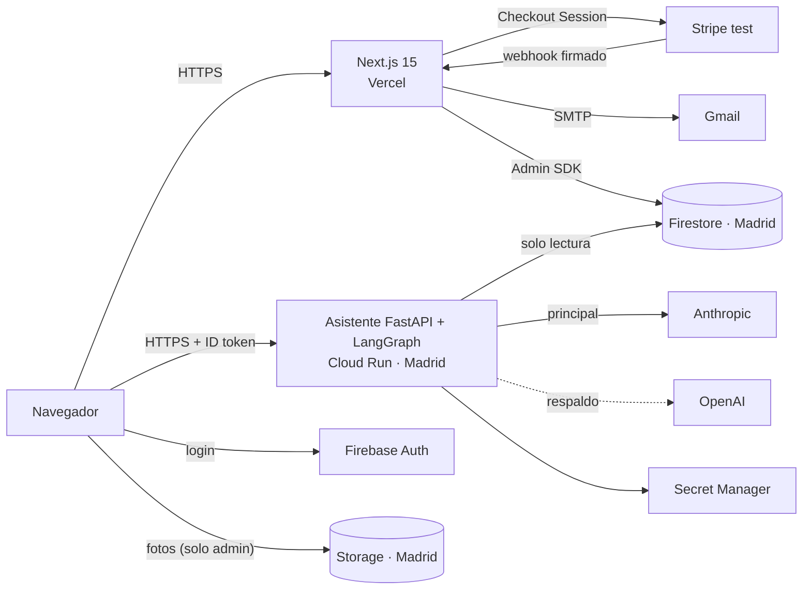
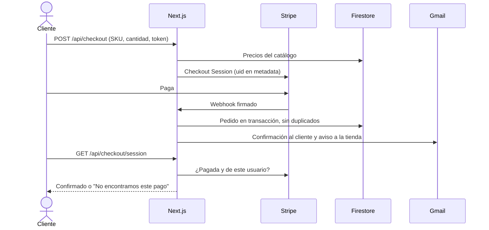
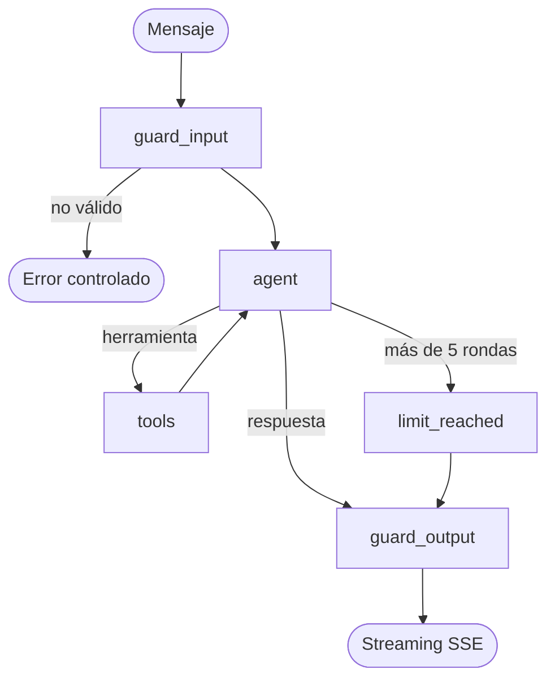

# Arquitectura — Colchones Contoso

> **Versión 2 · 16/10/2026 · Arquitectura implementada y desplegada.**
> Prueba técnica · Desarrollador Full Stack AI Native · Clearpoint.
> La versión 1, el plan inicial, se conserva en [`ARQUITECTURA_v1.md`](ARQUITECTURA_v1.md). El resumen con diagramas para la presentación está en [`PRESENTACION.md`](PRESENTACION.md) y el plan de QA en [`PLAN_DE_PRUEBAS.md`](PLAN_DE_PRUEBAS.md).

---

## 0. Historial de versiones

| Versión | Fecha | Estado | Resumen |
|---|---|---|---|
| 1 | 15/10/2026 | Histórica | Plan inicial: colchones de cuna, asistente con LiteLLM, email con Resend, sin panel |
| 2 | 16/10/2026 | **Vigente** | Implementación real: marca Contoso, asistente con LangGraph, Gmail, panel de administración, fotos en Storage, seguridad reforzada tras tres rondas de QA |

### Cambios de la versión 1 a la 2

| Área | Versión 1 | Versión 2 | Motivo |
|---|---|---|---|
| Producto | Colchones minicuna y cuna de la referencia | Marca Contoso con identidad colombiana, colchones de adulto Cafetal y Caribe | Identidad propia sin copiar la referencia. Se mantienen los ejes medida, núcleo y funda |
| Asistente | Bucle de tool calling con LiteLLM | Grafo de LangGraph en cascada: `guard_input`, `agent`, `tools`, `limit_reached` y `guard_output` | Control explícito de cada etapa y filtros de entrada y salida |
| Respaldo de IA | Router de LiteLLM | `with_fallbacks` de LangChain, Anthropic a OpenAI | Encaja con LangGraph y quita una dependencia |
| Autenticación | Correo y contraseña | Google y correo y contraseña. Política de 8 caracteres también en Firebase | Petición de producto y seguridad |
| Email | Resend | Gmail por SMTP con contraseña de aplicación | Resend exige dominio propio para enviar a cualquier cliente |
| Catálogo | Seed en Firestore, sin gestión | Firestore como única fuente, gestionado desde el panel. Sin vuelta al fichero de semilla | Un ecommerce no puede tener productos fijados en el código |
| Administración | Sin panel, estados por script | Panel `/admin`: colchones, fotos, pedidos, avisos por email y resumen | Operación real de la tienda |
| Fotos | Ficheros en `public/images` | Subida directa a Firebase Storage desde el panel | Gestión de imágenes sin redesplegar |
| Acceso de administrador | No existía | Claim `admin`, correo verificado y lista permitida, solo admin@contoso.example | Defensa en profundidad |
| Página de éxito | Consulta el pedido | Además pregunta a Stripe si la sesión existe, está pagada y es del usuario | QA detectó que confirmaba pagos inventados |
| Diseño | Sin definir | Paleta cálida, fotos de Unsplash, animaciones y microinteracciones | Experiencia de ecommerce |
| Flujo de trabajo | Commits en el repo | Ramas feature, PR a develop, PR a master protegida | Historial revisable |

---

## 1. Resumen

Ecommerce de colchones con:
- Home y dos fichas de producto configurables, carrito y pago con Stripe en modo test.
- Registro e inicio de sesión con Google o correo. Cada cliente ve solo sus pedidos.
- Email real de confirmación al cliente y aviso de pedido nuevo a la tienda.
- Asistente de IA de solo consulta sobre productos, envíos y devoluciones, y pedidos actualizados del cliente con sesión.
- Panel de administración para colchones, fotos y pedidos.
- Diseño responsive, desplegado en Vercel y Google Cloud con datos en Madrid.

---

## 2. Arquitectura general



| Componente | Responsabilidad | No hace |
|---|---|---|
| Next.js (Vercel) | Tienda, carrito, login, checkout, webhook, emails, panel y su API | No ejecuta el asistente |
| Asistente (Cloud Run) | Verifica el token y responde con herramientas de solo lectura | No escribe datos ni gestiona pagos |
| Firebase | Auth, Firestore y Storage | El navegador no escribe en Firestore |
| Stripe | Página de pago y confirmación por webhook | Las tarjetas no pasan por nuestros servidores |
| Gmail | Emails transaccionales | — |

---

## 3. Stack tecnológico

### Web — `web/`
| Tecnología | Uso |
|---|---|
| Next.js 15 (App Router) + TypeScript | Páginas, ISR y route handlers |
| Tailwind CSS | Estilos con tokens propios, modo oscuro y animaciones CSS |
| Zustand | Carrito persistido en el navegador |
| Zod | Validación compartida entre cliente y servidor |
| Firebase JS SDK | Auth, lectura de "Mis pedidos" y subida a Storage |
| firebase-admin | Webhook, catálogo, panel y verificación de tokens |
| stripe (Node) | Checkout Sessions, webhook y verificación de sesiones |
| Nodemailer + React Email | Emails por Gmail SMTP |
| react-markdown | Respuestas del asistente sin HTML crudo |
| Vitest + Testing Library | Pruebas |

### Asistente — `agent/`
| Tecnología | Uso |
|---|---|
| Python 3.12 + FastAPI + Uvicorn | API con streaming SSE |
| LangGraph + LangChain | Grafo en cascada y herramientas |
| langchain-anthropic / langchain-openai | Claude Sonnet 5.5 y GPT-5.4 mini de respaldo |
| firebase-admin | Verificación de tokens y lectura de Firestore |
| Pydantic | Configuración y validación |
| pytest | Pruebas |

### Infraestructura
| Servicio | Uso |
|---|---|
| Vercel | Web. Producción desde `master` y previews desde las demás ramas |
| Cloud Run `europe-southwest1` | Asistente, con cuenta `agent-sa` de solo lectura |
| Secret Manager | Claves de Anthropic y OpenAI |
| Firebase (Blaze) | Auth, Firestore y Storage en `europe-southwest1` |
| GitHub | Repositorio, PR y protección de `master` |

---

## 4. Estructura del repositorio

```
clearpoint-ai/
├── web/                 Next.js
│   ├── app/             Tienda, /admin, /api (checkout, webhooks, users, admin, catalog)
│   ├── components/      admin, auth, cart, chat, home, layout, orders, product, ui
│   ├── lib/             admin, auth, cart, catalog, chat, email, firebase, orders, ui
│   ├── emails/          Confirmación, aviso a la tienda y cambios de estado
│   └── tests/           api, components, security, unit
├── agent/               FastAPI + LangGraph (app/graph.py, tools.py, guards.py, prompts.py...)
├── firebase/            firestore.rules, storage.rules, índices y tests en emulador
├── scripts/             seed.ts, set-admin.ts, update-order-status.ts
├── data/                Semilla: catálogo, política de envíos y pedidos de demo
├── ARQUITECTURA.md      Este documento (versión 2)
├── ARQUITECTURA_v1.md   Plan inicial (histórico)
├── PRESENTACION.md      Resumen con diagramas
├── PLAN_DE_PRUEBAS.md   Plan de QA
└── README.md
```

---

## 5. Modelo de datos (Firestore)

| Colección | Clave | Contenido |
|---|---|---|
| `products/{slug}` | slug | Nombre, descripciones, imágenes, opciones, detalles, variantes (sku, opciones, precio, stock), etiqueta, activo |
| `content/shipping_policy` | — | Política de envíos y devoluciones en markdown |
| `users/{uid}` | uid | Email, nombre, foto y proveedor. Lo escribe solo el servidor |
| `orders/{stripeSessionId}` | id de sesión de Stripe | Número `CP-000xxx`, uid, email, estado, historial, líneas, totales, dirección, transportista, seguimiento, entrega estimada, `reviewedAt`, estados notificados |
| `counters/orders` | — | Contador del número de pedido, en transacción |

Índices: `orders (userId ASC, createdAt DESC)` y `orders (status ASC, createdAt DESC)`.

Storage: `products/{slug}/{timestamp}-{aleatorio}.webp`.

---

## 6. Flujos principales

### 6.1 Compra



### 6.2 Estados del pedido

`Pagado → En preparación → Enviado → Entregado`, y `Cancelado` desde Pagado o En preparación. Las transiciones se validan en servidor. Enviado exige transportista, seguimiento y fecha estimada. Enviado, Entregado y Cancelado envían email al cliente, una sola vez por estado.

### 6.3 Asistente



| Herramienta | Requiere sesión | Fuente |
|---|---|---|
| `list_products`, `get_product` | No | `products` |
| `get_shipping_policy` | No | `content/shipping_policy` |
| `list_my_orders`, `get_my_order` | Sí | `orders` del uid del token |

El uid nunca es parámetro de una herramienta: viaja en la configuración del grafo desde el token verificado.

### 6.4 Panel y fotos

1. El administrador sube fotos directamente a Storage. Las reglas exigen el rol, el correo, menos de 5 MB y tipo imagen. El navegador las comprime antes a WebP de 1600 px.
2. Al guardar, la API de admin valida el producto con Zod y escribe con el Admin SDK.
3. Después revalida la home y la ficha. El asistente ve el cambio en su siguiente consulta.

---

## 7. Seguridad

| Riesgo | Mitigación |
|---|---|
| Acceso a datos ajenos | Reglas de Firestore. uid siempre del token. Comprobación de propiedad en el asistente y en la página de éxito |
| Precio manipulado | Recalculado en servidor con el catálogo de Firestore |
| Pedidos falsos | Solo desde el webhook firmado e idempotente |
| Pagos inventados en la página de éxito | Verificación con Stripe antes de confirmar o vaciar el carrito |
| Escalada a administrador | Claim `admin` que solo pone el servidor, correo verificado y `ADMIN_EMAILS`, en la API, en la UI, en Storage y en `set-admin` |
| Prompt injection | Herramientas de solo lectura sin parámetro de usuario. Filtro de salida |
| Consumo de IA | Límites de tokens, historial, rondas y mensajes por usuario |
| Secretos | Fuera del repositorio y de `NEXT_PUBLIC_`. Claves de IA en Secret Manager |
| Contraseñas | Mínimo 8 caracteres en la web y en Firebase. Protección contra la enumeración de correos |
| Cabeceras | CSP, X-Frame-Options, X-Content-Type-Options, Referrer-Policy. CORS del asistente restringido |
| Mínimo privilegio | `agent-sa` con `datastore.viewer`. `agent-builder` con `run.builder` |

---

## 8. Variables de entorno

### Web
| Variable | Tipo |
|---|---|
| `NEXT_PUBLIC_FIREBASE_API_KEY`, `NEXT_PUBLIC_FIREBASE_AUTH_DOMAIN`, `NEXT_PUBLIC_FIREBASE_PROJECT_ID`, `NEXT_PUBLIC_FIREBASE_APP_ID`, `NEXT_PUBLIC_FIREBASE_STORAGE_BUCKET` | Pública |
| `NEXT_PUBLIC_STRIPE_PUBLISHABLE_KEY`, `NEXT_PUBLIC_AGENT_URL`, `NEXT_PUBLIC_SITE_URL` | Pública |
| `FIREBASE_ADMIN_CREDENTIALS`, `STRIPE_SECRET_KEY`, `STRIPE_WEBHOOK_SECRET`, `GMAIL_APP_PASSWORD` | Secreta |
| `GMAIL_USER`, `EMAIL_FROM_NAME`, `ADMIN_NOTIFICATION_EMAIL`, `ADMIN_EMAILS` | Configuración |

### Asistente
`ANTHROPIC_API_KEY` y `OPENAI_API_KEY` desde Secret Manager. Además: `ANTHROPIC_MODEL`, `ANTHROPIC_EFFORT`, `OPENAI_MODEL`, `FORCE_FALLBACK`, `REPOSITORY_BACKEND`, `FIREBASE_PROJECT_ID`, `ALLOWED_ORIGINS` y `LOG_LEVEL`.

---

## 9. Despliegue

| Pieza | Método |
|---|---|
| Web | Integración de GitHub con Vercel, Root Directory `web`. Producción al fusionar en `master` |
| Asistente | `gcloud run deploy agent --source agent --region europe-southwest1` con `agent-sa`, `agent-builder` y secretos |
| Reglas e índices | `firebase deploy --only firestore:rules,firestore:indexes,storage` |
| Webhook | `https://clearpoint-ai.vercel.app/api/webhooks/stripe`, evento `checkout.session.completed` |
| Rol de administrador | `npm run admin:set -- admin@contoso.example` en `scripts/` |

---

## 10. Pruebas

| Suite | Pruebas |
|---|---|
| Web | 315 |
| Asistente | 138 |
| Reglas de Firestore y Storage | 32 |
| Scripts | 10 |
| **Total** | **495** |

Además hay 94 casos manuales en [`PLAN_DE_PRUEBAS.md`](PLAN_DE_PRUEBAS.md). QA hizo tres rondas sobre la aplicación desplegada y cada defecto tiene su prueba de regresión.

---

## 11. Limitaciones conocidas

- El límite de mensajes del asistente es por instancia de Cloud Run.
- Cancelar un pedido no lo reembolsa en Stripe.
- La tarifa de envío no se valida con el código postal.
- "A medida" no recoge las medidas en la web.
- Las fotos que se quitan del formulario se quedan en Storage.
- El correo de administrador está fijado también en las reglas de Storage.
- El email sale de Gmail y puede llegar a spam.
- La credencial de Firebase Admin está exportada en Vercel. Se podría sustituir por Workload Identity Federation.
