# Colchones Contoso · Presentación técnica

Ecommerce de colchones con pago de prueba, panel de administración y asistente de IA de consulta.
Prueba técnica para Desarrollador Full Stack AI Native en Clearpoint.

Este documento resume la solución tal como está construida y desplegada. El detalle está en [`ARQUITECTURA.md`](ARQUITECTURA.md) (versión 2; el plan inicial es la [versión 1](ARQUITECTURA_v1.md)), el plan de QA en [`PLAN_DE_PRUEBAS.md`](PLAN_DE_PRUEBAS.md) y la puesta en marcha en el [`README.md`](README.md).

| | |
|---|---|
| Tienda | https://clearpoint-ai.vercel.app |
| Panel de administración | https://clearpoint-ai.vercel.app/admin |
| Asistente | https://agent-305860844301.europe-southwest1.run.app |
| Pruebas automáticas | 495, todas en verde |
| Casos manuales de QA | 94 |

---

## 0. Evolución de la arquitectura

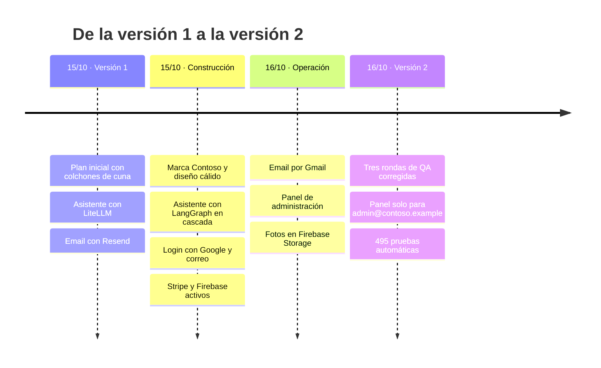

Los cambios detallados y su motivo están en el historial de versiones de [`ARQUITECTURA.md`](ARQUITECTURA.md#0-historial-de-versiones).

---

## 1. Qué pide la prueba y cómo se resuelve

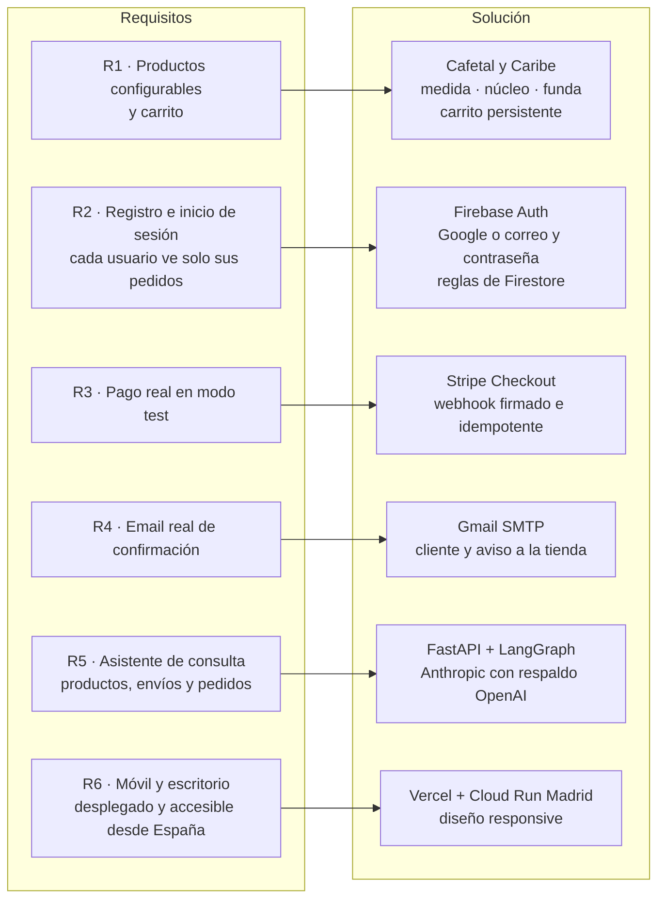

Además de lo pedido: panel de administración para colchones, fotos y pedidos, con avisos por email.

---

## 2. Arquitectura general

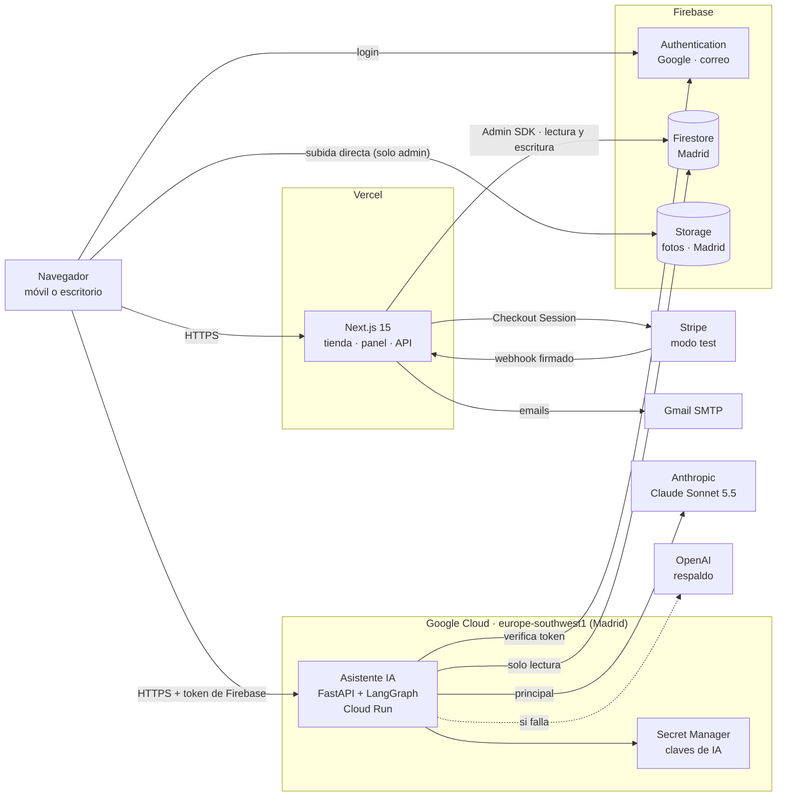

| Pieza | Responsabilidad | No hace |
|---|---|---|
| Next.js en Vercel | Tienda, carrito, login, pago, webhook, emails y panel | No ejecuta el asistente |
| Asistente en Cloud Run | Verifica el token y responde con herramientas de consulta | No escribe datos ni gestiona pagos |
| Firebase | Usuarios, datos y fotos | El navegador no puede escribir en Firestore |
| Stripe | Página de pago y confirmación por webhook | Las tarjetas nunca pasan por nuestros servidores |

---

## 3. Flujo de compra

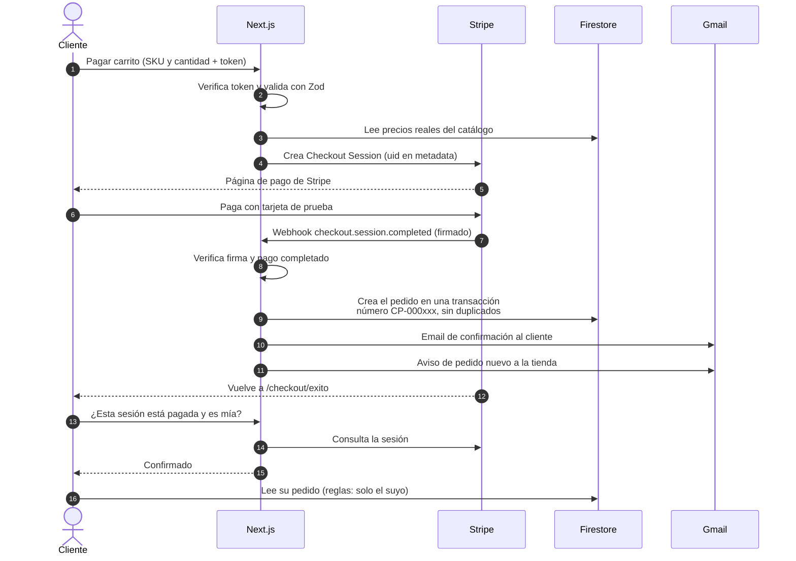

- El cliente solo envía SKU y cantidad. **El precio siempre lo calcula el servidor.**
- **El pedido solo nace del webhook firmado**, nunca de la página de éxito.
- La página de éxito pregunta a Stripe antes de confirmar. Un identificador inventado muestra "No encontramos este pago".
- Si el email falla, el pedido se guarda igual.

---

## 4. Ciclo de vida de un pedido

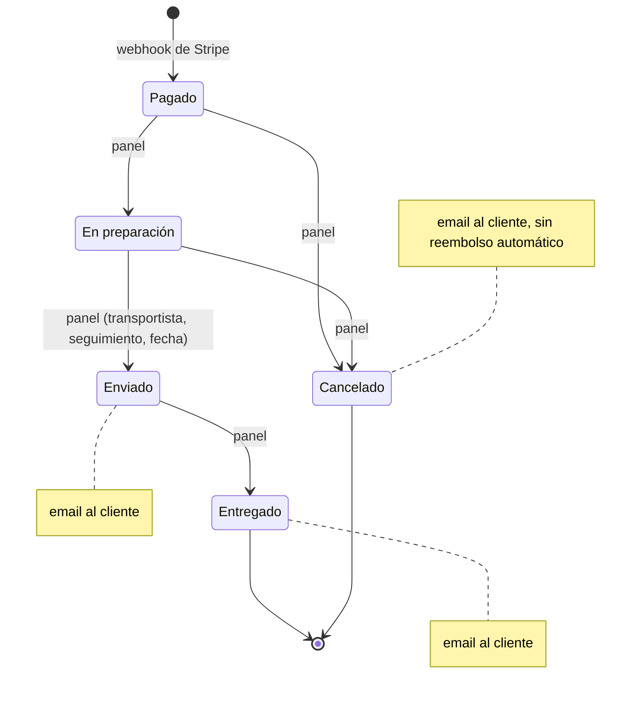

El servidor rechaza cualquier salto no permitido. El asistente lee el estado en cada consulta, así que ve el cambio al momento.

---

## 5. Asistente de IA

### Grafo de LangGraph

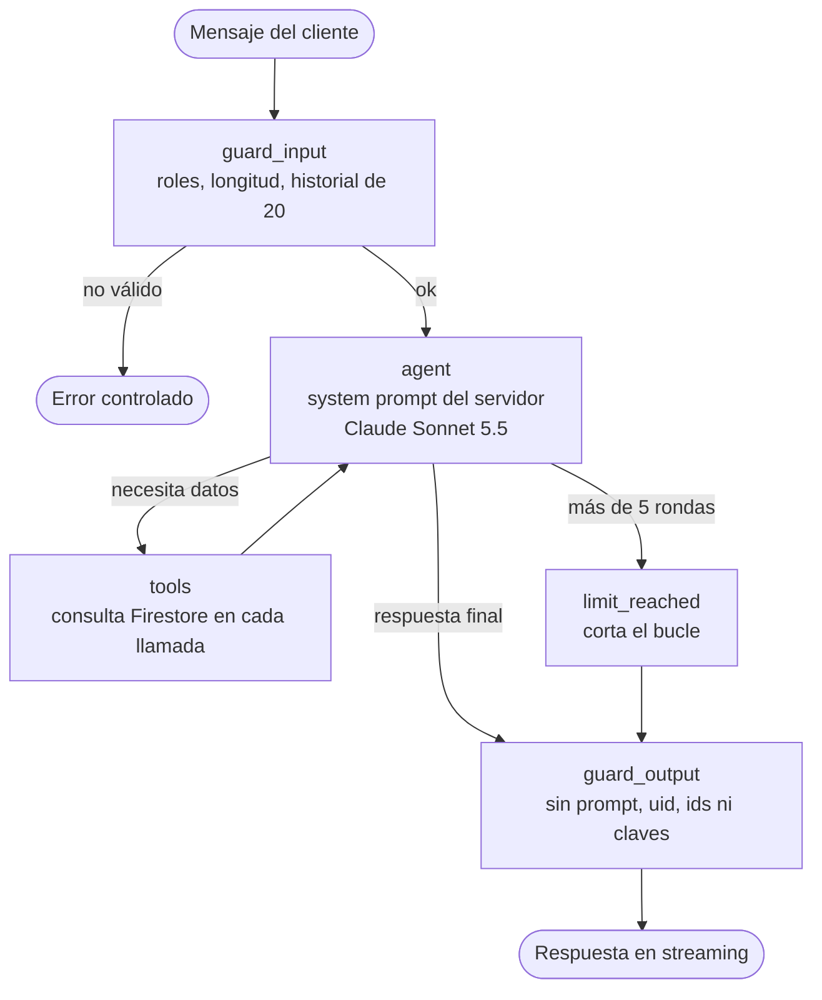

### Autenticación híbrida

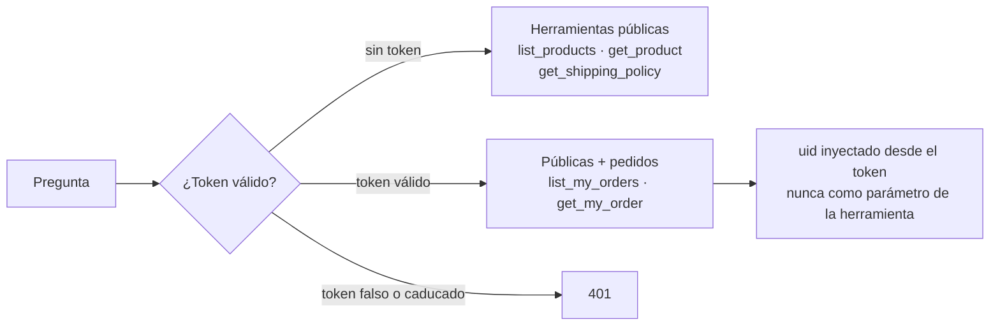

| Control | Valor |
|---|---|
| Modelo principal y respaldo | Claude Sonnet 5.5, y GPT-5.4 mini si falla por 429, 5xx o timeout |
| Límites | 1000 caracteres por mensaje, 20 de historial, 5 rondas de herramientas, 1024 tokens |
| Uso | 20 mensajes cada 10 minutos por usuario o IP |
| Prompt injection | El modelo no puede elegir de quién lee: el uid sale del token |
| Respuestas | Streaming SSE. Fechas en hora peninsular y estados con los mismos nombres que la web |

---

## 6. Modelo de datos

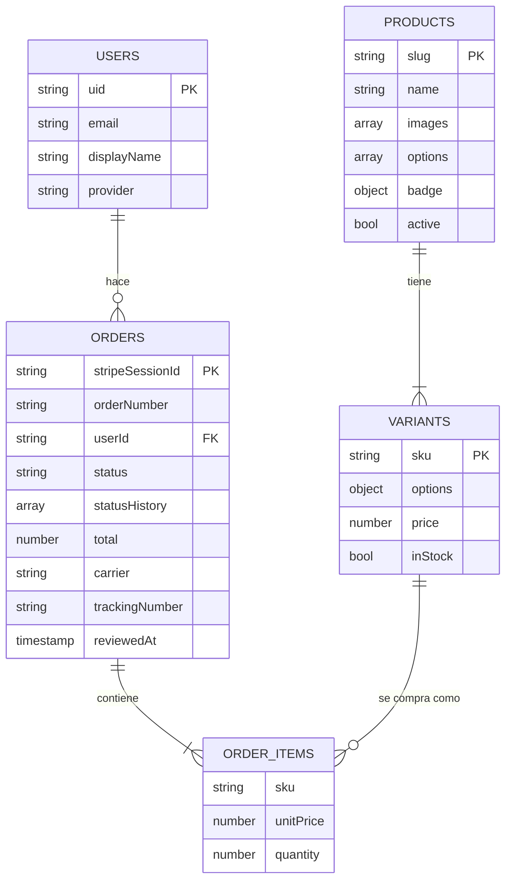

- El identificador del pedido es el de la sesión de Stripe. Así el webhook no puede duplicarlo.
- `counters/orders` genera el número correlativo en una transacción.
- Los datos de los colchones viven en Firestore y se gestionan desde el panel. El fichero `data/catalog.json` solo es la semilla inicial.

---

## 7. Panel de administración y fotos

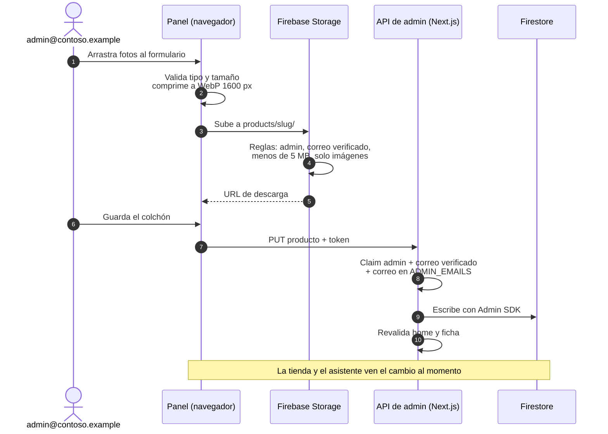

**Qué se gestiona:** colchones con variantes, precios, stock, fotos y etiqueta de tarjeta, y pedidos con filtros, cambio de estado y resumen del día.

---

## 8. Seguridad

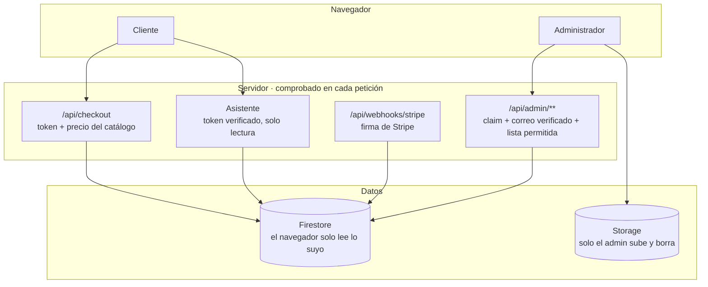

| Riesgo | Mitigación |
|---|---|
| Acceso a datos ajenos | Reglas de Firestore, uid siempre del token y comprobación de propiedad |
| Precio manipulado | El servidor recalcula con el catálogo de Firestore |
| Pedidos falsos | Solo desde el webhook firmado. La página de éxito pregunta a Stripe |
| Prompt injection | El asistente no puede elegir usuario y solo tiene herramientas de lectura |
| Escalada a administrador | Claim que solo pone el servidor, correo verificado y lista permitida, también en Storage |
| Secretos | Ninguno en el repositorio ni con prefijo `NEXT_PUBLIC_`. Claves de IA en Secret Manager |
| Contraseñas | Mínimo 8 caracteres también en Firebase y protección contra la enumeración de correos |
| Cabeceras | CSP, X-Frame-Options, X-Content-Type-Options, Referrer-Policy y CORS restringido |

---

## 9. Despliegue

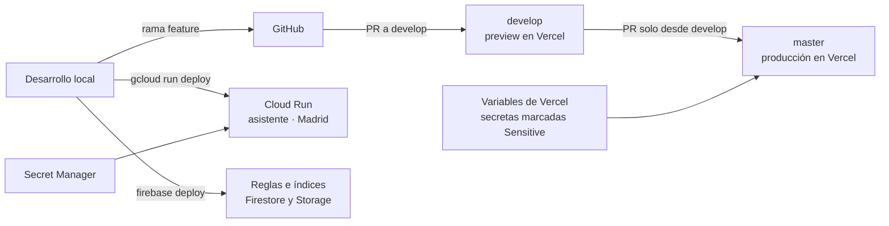

`master` está protegida: solo admite PR desde `develop` y bloquea el push directo, el force push y el borrado.

---

## 10. Estrategia de pruebas

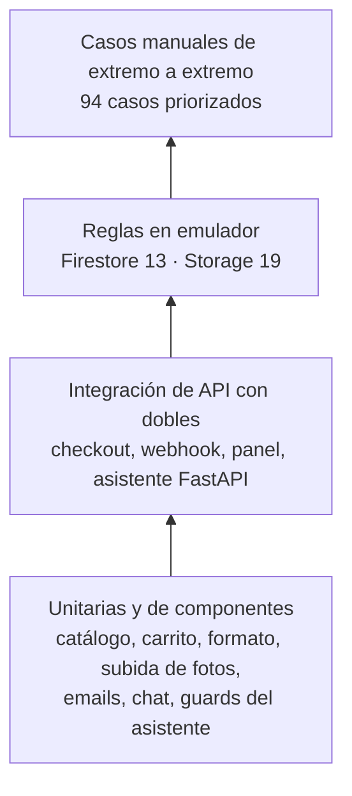

| Suite | Pruebas |
|---|---|
| Web (Vitest) | 315 |
| Asistente (pytest) | 138 |
| Reglas de Firestore y Storage | 32 |
| Scripts | 10 |
| **Total** | **495** |

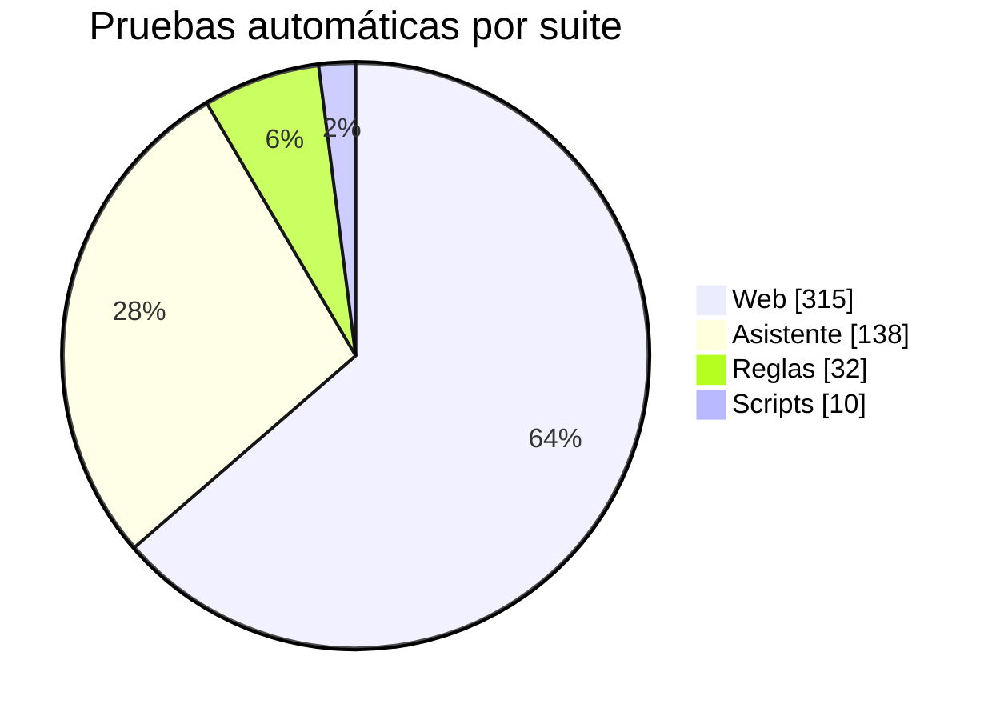

QA hizo tres rondas sobre la aplicación desplegada. Todos los defectos encontrados están corregidos y tienen su prueba de regresión:
- el asistente se corregía sin motivo;
- fechas y estados distintos entre la web y el asistente;
- opciones en distinto orden;
- el botón del chat tapaba contenido;
- palabras largas se salían del chat;
- la página de éxito aceptaba pagos inventados.

---

## 11. Guion de la demo

1. **Home y ficha.** Recorrer la home, configurar un Caribe y ver cómo cambia el precio.
2. **Carrito.** Añadir al carrito, abrir el mini carrito y cambiar cantidades.
3. **Asistente sin sesión.** Preguntar qué colchón conviene si duermes de lado y pasas calor, y cuánto tarda el envío a Canarias.
4. **Login.** Entrar con Google o con demo1.
5. **Pago.** Pagar con la tarjeta 4242 y ver la página de éxito con el número de pedido. Mostrar el email de confirmación.
6. **Asistente con sesión.** Preguntar "¿Dónde está mi pedido?".
7. **Prompt injection.** Pedir los pedidos de otro usuario y ver que se niega.
8. **Panel.** Entrar como administrador. Ver el aviso de pedido nuevo y pasar el pedido a En preparación y luego a Enviado con seguimiento.
9. **Datos actualizados.** Volver al asistente y ver el estado nuevo con el número de seguimiento.
10. **Fotos.** Subir una foto a un colchón y verla en la tienda.
11. **Respaldo de IA.** Si hay tiempo, forzar el fallo de Anthropic y ver que responde OpenAI.

---

## 12. Decisiones principales

| Decisión | Motivo |
|---|---|
| Marca propia con identidad colombiana y colchones de adulto | Identidad propia sin copiar la referencia, con los mismos ejes de configuración |
| Asistente separado en Python con LangGraph | Etapas de control explícitas y aislamiento: el asistente no puede escribir ni ver secretos de la tienda |
| Anthropic con respaldo de OpenAI | Disponibilidad ante errores del proveedor |
| Pedidos solo desde el webhook | Integridad: no se puede crear un pedido sin pago confirmado |
| Gmail en lugar de Resend | Resend exige dominio propio para enviar a cualquier cliente |
| Catálogo en Firestore con panel | Un ecommerce no puede tener los productos fijados en el código |
| Subida directa a Storage con reglas | Evita el límite de tamaño de las funciones y protege el acceso en origen |

## 13. Limitaciones conocidas

- El límite de mensajes del asistente es por instancia de Cloud Run.
- Cancelar un pedido no lo reembolsa en Stripe.
- La tarifa de envío la elige el comprador y no se valida con el código postal.
- La opción "A medida" no recoge las medidas en la web.
- Las fotos que se quitan del formulario se quedan en Storage.
- El email sale de una cuenta de Gmail y puede llegar a spam.
