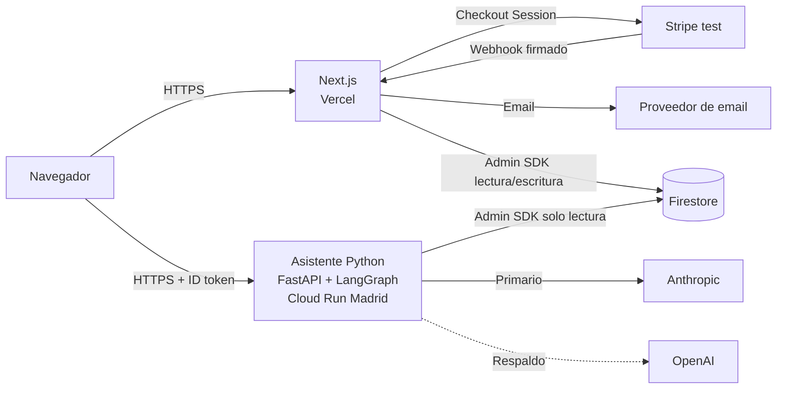

# Colchones Contoso · Ecommerce con asistente IA

Prueba técnica para el puesto de **Desarrollador Full Stack AI Native** en Clearpoint.

Contoso es una tienda online de colchones de adulto con identidad colombiana: taller en Bogotá, fundas de algodón del Tolima y envíos a toda España. Permite configurar un colchón, comprarlo con un pago de prueba de Stripe y consultar después el pedido con un asistente de IA.

> **Estado:** en desarrollo. La tabla de [Estado del proyecto](#estado-del-proyecto) dice qué está terminado y qué falta. Este README se actualiza en cada iteración.

---

## Índice

1. [Qué hace](#qué-hace)
2. [Estado del proyecto](#estado-del-proyecto)
3. [Arquitectura](#arquitectura)
4. [Estructura del repositorio](#estructura-del-repositorio)
5. [Puesta en marcha rápida](#puesta-en-marcha-rápida)
6. [Variables de entorno](#variables-de-entorno)
7. [Pruebas](#pruebas)
8. [Datos y accesos de demostración](#datos-y-accesos-de-demostración)
9. [Despliegue](#despliegue)
10. [Seguridad](#seguridad)
11. [Decisiones y cambios respecto al plan inicial](#decisiones-y-cambios-respecto-al-plan-inicial)
12. [Limitaciones conocidas](#limitaciones-conocidas)
13. [Créditos](#créditos)

---

## Qué hace

| Requisito de la prueba | Cómo se resuelve |
|---|---|
| Productos configurables según la referencia y compra con carrito | Dos colchones, **Cafetal** y **Caribe**, configurables por medida, núcleo y funda. El carrito se guarda en el navegador. |
| Registro e inicio de sesión. Cada usuario ve solo sus pedidos | Firebase Auth con **Google** o **correo y contraseña**. Los pedidos están protegidos por reglas de Firestore. |
| Pago real en modo de prueba y email de confirmación | Stripe Checkout en modo test. El webhook firmado crea el pedido y envía el email. |
| Asistente de consulta sobre productos, envíos y pedidos | Servicio Python con **LangGraph**. Herramientas de solo lectura y respuesta en streaming. |
| Móvil y escritorio, desplegado y accesible desde España | Diseño responsive. Web en Vercel (región europea) y asistente en Cloud Run (Madrid). |

---

## Estado del proyecto

| Pieza | Carpeta | Estado |
|---|---|---|
| Diseño visual de la home | — | ✅ Aprobado |
| Datos compartidos (catálogo, política, pedidos demo) | [`data/`](data/README.md) | ✅ Hecho |
| Asistente IA (FastAPI + LangGraph) | [`agent/`](agent/README.md) | ✅ Desplegado en Cloud Run y probado con Anthropic y con el respaldo de OpenAI |
| Web (Next.js): interfaz, carrito, auth, checkout, webhook | [`web/`](web/README.md) | ✅ Hecho en local: build, lint y typecheck limpios. Falta la prueba de extremo a extremo con credenciales |
| Reglas e índices de Firestore | [`firebase/`](firebase/README.md) | ✅ Hecho y probado en el emulador. Falta desplegarlas |
| Reglas de Storage (fotos de producto del panel) | [`firebase/`](firebase/README.md#reglas-de-storage) | ✅ Probadas en el emulador. Falta desplegarlas (`firebase deploy --only storage`) |
| Scripts de seed y de estados de pedido | [`scripts/`](scripts/README.md) | ✅ Probados contra los emuladores |
| Pruebas unitarias y de seguridad | `agent/tests`, `web/tests`, `firebase/tests` | ✅ 241 pruebas en verde |
| Proyecto Firebase con reglas, índices y datos de demo | `firebase/`, `scripts/` | ✅ Activo y verificado |
| Stripe en modo test | `web/` | ✅ Checkout probado en local y webhook de producción creado |
| Email de confirmación por Gmail | `web/` | ✅ Envío real probado |
| Panel de administración: colchones, pedidos y avisos por email | `web/app/admin`, `scripts/set-admin.ts` | ✅ Hecho y probado con dobles. Falta asignar el rol admin en el proyecto real |
| Despliegue de la web en Vercel | — | ⏳ Pendiente de variables y de llevar el código a master |
| Memoria técnica | `docs/` | ⏳ Pendiente |

---

## Arquitectura

El documento completo está en [`ARQUITECTURA.md`](ARQUITECTURA.md), versión 2. El plan inicial se conserva como versión 1 en [`ARQUITECTURA_v1.md`](ARQUITECTURA_v1.md) y los diagramas para la presentación están en [`PRESENTACION.md`](PRESENTACION.md). Este es el resumen:



- **Web (Next.js).** Interfaz, carrito, autenticación en cliente, creación del pago y recepción del webhook de Stripe. Es la única pieza que escribe pedidos.
- **Asistente (Python).** Verifica el token del usuario y ejecuta un grafo de LangGraph en cascada: filtro de entrada, modelo, herramientas y filtro de salida. Solo lee datos.
- **Firebase.** Usuarios con Auth y datos con Firestore.
- **Stripe.** Página de pago alojada. Los datos de tarjeta nunca pasan por nuestros servidores.

---

## Estructura del repositorio

```
clearpoint-ai/
├── web/            Tienda Next.js (interfaz, carrito, auth, checkout, webhook)  → web/README.md
├── agent/          Asistente IA en Python (FastAPI + LangGraph)                 → agent/README.md
├── data/           Catálogo, política de envíos y pedidos demo (fuente única)   → data/README.md
├── firebase/       Reglas de Firestore y Storage, índices y sus tests           → firebase/README.md
├── scripts/        Seed de datos y avance de estados de pedido                  → scripts/README.md
├── webbase/        Páginas de referencia de Clearpoint (solo consulta local, excluida de Git)
├── docs/           Memoria técnica
├── ARQUITECTURA.md Documento de arquitectura vigente (versión 2)
├── ARQUITECTURA_v1.md Plan inicial (versión 1, histórico)
├── PRESENTACION.md Resumen con diagramas Mermaid para la presentación
├── PLAN_DE_PRUEBAS.md Plan de pruebas para QA: pruebas automáticas y casos manuales
└── README.md       Este documento
```

Cada carpeta tiene su propio README con el detalle de cómo funciona, cómo se ejecuta y cómo se prueba.

---

## Puesta en marcha rápida

**Requisitos:** Node.js 20, Python 3.12, Firebase CLI y, para probar pagos, Stripe CLI.

```bash
# 1. Asistente IA
cd agent
python3.12 -m venv .venv && source .venv/bin/activate
pip install -r requirements.txt -r requirements-dev.txt
cp .env.example .env          # rellenar claves
uvicorn app.main:app --reload --port 8080

# 2. Web (en otra terminal)
cd web
npm install
cp .env.example .env.local    # rellenar claves
npm run dev                   # http://localhost:3000

# 3. Webhook de Stripe en local (en otra terminal)
stripe listen --forward-to localhost:3000/api/webhooks/stripe
```

Los comandos exactos y las opciones sin credenciales están en el README de cada carpeta.

---

## Panel de administración

Ruta `/admin`, solo para cuentas con el rol de administrador. El detalle está en [`web/README.md`](web/README.md).

- **Colchones.** Crear, editar, activar, desactivar y borrar productos, con sus opciones, variantes, precios, stock, imágenes y etiqueta de tarjeta. Los cambios se ven en la tienda y en el asistente al momento.
- **Pedidos.** Lista del más reciente al más antiguo, filtro por estado y distintivo de pedido nuevo. El estado avanza de Pagado a En preparación, Enviado y Entregado, o pasa a Cancelado desde los dos primeros. Al pasar a Enviado se piden transportista, seguimiento y fecha estimada.
- **Emails.** La tienda recibe un aviso por cada pedido nuevo. El cliente recibe un email al pasar a Enviado, Entregado o Cancelado, salvo que se desmarque la casilla.
- **Resumen.** Pedidos y facturación del día, pendientes de preparar y enviados.

Los datos de los colchones viven en Firestore. El fichero `data/catalog.json` solo sirve como semilla inicial y para desarrollo sin credenciales.

Dar o quitar el rol a una cuenta que ya haya iniciado sesión al menos una vez:

```bash
cd scripts && npm run admin:set -- correo@dominio.com
cd scripts && npm run admin:set -- correo@dominio.com --revoke
```

---

## Variables de entorno

Ningún secreto se guarda en el repositorio. Cada proyecto incluye un `.env.example` sin valores.

| Proyecto | Fichero | Detalle |
|---|---|---|
| Web | `web/.env.example` | [web/README.md](web/README.md#variables-de-entorno) |
| Asistente | `agent/.env.example` | [agent/README.md](agent/README.md#variables-de-entorno) |

Regla de oro: solo las variables con prefijo `NEXT_PUBLIC_` llegan al navegador, y ninguna de ellas es secreta.

---

## Pruebas

El plan completo para QA, con los casos manuales de extremo a extremo, está en [`PLAN_DE_PRUEBAS.md`](PLAN_DE_PRUEBAS.md).

| Proyecto | Comando | Qué cubre |
|---|---|---|
| Asistente | `cd agent && pytest --cov` | Aislamiento entre usuarios, token inválido, prompt injection, límites, fallback y nodos del grafo |
| Web | `cd web && npm test` | Checkout, webhook, idempotencia, carrito, configurador, cliente SSE y cabeceras de seguridad |
| Reglas Firestore y Storage | `cd firebase && npm run test:rules` | Lectura propia permitida, ajena denegada y escrituras de cliente bloqueadas; fotos de producto: solo admin@contoso.example (verificado y con claim admin) sube (< 5 MB, JPEG/PNG/WebP/AVIF), lectura pública. Requiere Java 21 (`JAVA_HOME`) |

Última ejecución:

| Proyecto | Fecha | Resultado |
|---|---|---|
| Asistente | 15/10/2026 | 133 tests en verde, 94 % de cobertura |
| Web | 15/10/2026 | 97 tests en verde. Cobertura del 100 % en checkout y webhook |
| Reglas Firestore | 15/10/2026 | 11 tests en verde con el emulador |

---

## Datos y accesos de demostración

Los datos se cargan con `scripts/seed.ts` desde la carpeta [`data/`](data/README.md). El seed es idempotente: se puede ejecutar varias veces sin duplicar nada.

| Usuario | Contraseña | Pedidos |
|---|---|---|
| `demo1@contoso.example` | `Tolima-Siesta-4732` | 3 pedidos: CP-000101 entregado, CP-000118 enviado con seguimiento y CP-000123 pagado |
| `demo2@contoso.example` | `Caribe-Panela-1348` | 1 pedido: CP-000120 en preparación, a medida y con envío a Baleares |
| `admin@contoso.example` | Se entrega por un canal privado, nunca en el repositorio | Ninguno. Es la única cuenta que puede entrar al panel en `/admin` |

También se puede crear una cuenta nueva con correo y contraseña o entrar con Google. Las cuentas nuevas no son administradoras.

**Pago de prueba:** tarjeta `4242 4242 4242 4242`, cualquier fecha futura y cualquier CVC. La tarjeta `4000 0000 0000 0002` simula un pago rechazado.

**Probar que el asistente ve datos actualizados:** cambia el estado de un pedido y pregunta de nuevo al asistente.

```bash
cd scripts && npx tsx --env-file=.env update-order-status.ts CP-000123 shipped
```

---

## Despliegue

| Pieza | Plataforma | Región | Estado |
|---|---|---|---|
| Web | Vercel (Root Directory `web`), dominio `clearpoint-ai.vercel.app` | Europa (`fra1`) | ⏳ Falta llevar el código a master y cargar las variables |
| Asistente | Google Cloud Run, servicio `agent` en `https://agent-305860844301.europe-southwest1.run.app` | `europe-southwest1` (Madrid) | ✅ Activo |
| Auth y Firestore | Firebase, proyecto `clearpoint-colchones` | — | ✅ Activo |
| Pagos | Stripe en modo test. Webhook `checkout.session.completed` hacia `https://clearpoint-ai.vercel.app/api/webhooks/stripe` | — | ✅ Creado |

### Firebase

| Elemento | Estado |
|---|---|
| Proyecto | `clearpoint-colchones` |
| Authentication | Correo y contraseña y Google activados. Dominios autorizados: `localhost`, los de Firebase y `clearpoint-ai.vercel.app` |
| Firestore | Base de datos `(default)` en modo nativo |
| Storage | Bucket `clearpoint-colchones.firebasestorage.app` (europe-southwest1) para las fotos de producto. Reglas en `firebase/storage.rules` |
| Reglas e índices | Desplegados desde `firebase/` |
| Datos de demo | Cargados con el seed |

La configuración web de Firebase es pública por diseño y se rellena en `web/.env.local`. La credencial de administrador es secreta: se guarda en base64 en `FIREBASE_ADMIN_CREDENTIALS`, nunca en el repositorio.

Reglas verificadas contra el proyecto real con el usuario demo1:

| Prueba | Resultado |
|---|---|
| Leer sus propios pedidos | Permitido, 3 pedidos |
| Leer los pedidos de demo2 | Denegado |
| Listar todos los pedidos | Denegado |
| Leer un producto sin sesión | Permitido |

### Asistente en Cloud Run

| Elemento | Valor |
|---|---|
| Cuenta de servicio en ejecución | `agent-sa`, con `roles/datastore.viewer` y acceso solo a sus dos secretos |
| Cuenta de servicio de compilación | `agent-builder`, con `roles/run.builder` |
| Secretos | `anthropic-key` y `openai-key` en Secret Manager |
| Modelos | `claude-sonnet-5-5` principal y `gpt-5.4-mini` de respaldo |
| Instancias | Mínimo 1 y máximo 3 |
| Orígenes permitidos | `https://clearpoint-ai.vercel.app` y `http://localhost:3000` |

Pruebas contra el servicio desplegado, del 15/10/2026:

| Prueba | Resultado |
|---|---|
| Pregunta de producto sin sesión | Responde con Anthropic consultando el catálogo |
| "Lista mis pedidos" con demo1 | Devuelve solo sus 3 pedidos con el estado actual |
| Token falso | 401 |
| Petición desde un origen no permitido | CORS rechazado |
| Pedido de demo2 pedido por demo1 con prompt injection, en local | "No encontrado" |
| Anthropic forzado a fallar, en local | Responde OpenAI |

URL pública: https://clearpoint-ai.vercel.app (pendiente de primer despliegue con la web).

---

## Seguridad

Resumen. El detalle está en la sección 7 de [`ARQUITECTURA.md`](ARQUITECTURA.md).

- Los precios se recalculan en el servidor. El cliente solo envía SKU y cantidad.
- Los pedidos solo se crean desde el webhook firmado de Stripe y de forma idempotente.
- El asistente toma el identificador del usuario del token verificado y nunca del modelo. Así no puede leer pedidos ajenos aunque sufra prompt injection.
- El asistente es de solo lectura, también a nivel de permisos de infraestructura.
- Las reglas de Firestore impiden leer pedidos ajenos y cualquier escritura desde el navegador.
- Hay cabeceras de seguridad, CORS restringido y límites de uso del asistente.
- El panel de administración solo admite a `admin@contoso.example`. Se exigen a la vez el rol `admin` de Firebase, el correo verificado y que el correo esté en `ADMIN_EMAILS`. Se comprueba en el servidor en cada petición, en las reglas de Storage y en el script que concede el rol.
- La contraseña de administrador no está en el repositorio. Las de los clientes de demo solo dan acceso a pedidos de prueba.
- Firebase exige contraseñas de al menos 8 caracteres también en el servidor y tiene activada la protección contra la enumeración de correos.
- Las fotos se suben directamente a Firebase Storage. Solo el administrador puede subir o borrar, con un máximo de 5 MB y solo imágenes JPG, PNG, WebP o AVIF dentro de `products/`.

**Auditoría del 16/10/2026**

| Revisión | Resultado |
|---|---|
| Secretos en ficheros actuales (gitleaks) | Ninguno |
| Secretos en todo el historial de Git | Solo la configuración web de Firebase en el primer commit, que es pública por diseño |
| Ficheros `.env` con valores reales | Todos ignorados por Git |
| Dependencias Python del asistente (pip-audit, 88 paquetes) | Sin vulnerabilidades |
| Dependencias npm que llegan a producción | Sin críticas ni altas. Quedan avisos moderados de `uuid` dentro de las librerías de Google, no explotables en nuestro uso |
| Dependencias npm solo de desarrollo | Quedan avisos de vitest, eslint y firebase-tools. No se despliegan |

---

## Decisiones y cambios respecto al plan inicial

| Fecha | Decisión | Motivo |
|---|---|---|
| 15/10/2026 | Marca propia **Contoso** con identidad colombiana y colchones de adulto | Dar identidad propia sin copiar la referencia. Se mantienen los mismos ejes de configuración: medida, núcleo y funda |
| 15/10/2026 | Paleta cálida y fotos reales de Unsplash | Petición de diseño. Las fotos tienen licencia libre y llevan crédito |
| 15/10/2026 | Asistente con **LangGraph** en cascada en lugar de un bucle con LiteLLM | Más control sobre cada etapa de la respuesta y mejor trazabilidad |
| 15/10/2026 | Respaldo Anthropic → OpenAI con el mecanismo de LangChain | Encaja con LangGraph y quita una dependencia |
| 15/10/2026 | Login con **Google** además de correo y contraseña | Petición de producto |
| 15/10/2026 | Email de confirmación por **Gmail (SMTP)** en lugar de Resend | Resend exige un dominio propio para enviar a cualquier cliente y no lo tenemos |
| 16/10/2026 | **Panel de administración** con rol `admin` en Firebase y escrituras solo desde el servidor | Un ecommerce no puede tener los productos fijados en el código |
| 16/10/2026 | Sin vuelta al catálogo local cuando se usa Firestore | Un colchón borrado reaparecía al mostrarse el fichero de semilla |
| 15/10/2026 | Pruebas unitarias y de seguridad desde el inicio | Garantizar aislamiento entre usuarios y la integridad del pago |

---

## Limitaciones conocidas

Se irán ampliando. Las actuales son estas:

- El límite de mensajes del asistente vive en memoria y no se comparte entre instancias.
- Las fotos subidas desde el panel solo se borran de Storage al eliminar el producto. Quitar una foto del formulario no borra el fichero, así que pueden quedar huérfanos (también si se sube una foto a un producto nuevo y no se guarda).
- Cancelar un pedido en el panel no hace el reembolso en Stripe.
- No hay gestión real de stock ni de impuestos por región.
- El email de confirmación sale de una cuenta de Gmail. Tiene un límite diario de unos 500 envíos y puede acabar en spam. Los usuarios demo tienen correos ficticios, así que para ver el email hay que comprar con una cuenta real o con Google.

---

## Créditos

Fotografías de [Unsplash](https://unsplash.com) bajo la licencia de Unsplash: Matthieu Lemarchal, Deconovo, Nathan Van Egmond, Costa Live y Roberto Nickson.

Proyecto desarrollado con ayuda de herramientas de IA. Su uso se detalla en la memoria técnica.
