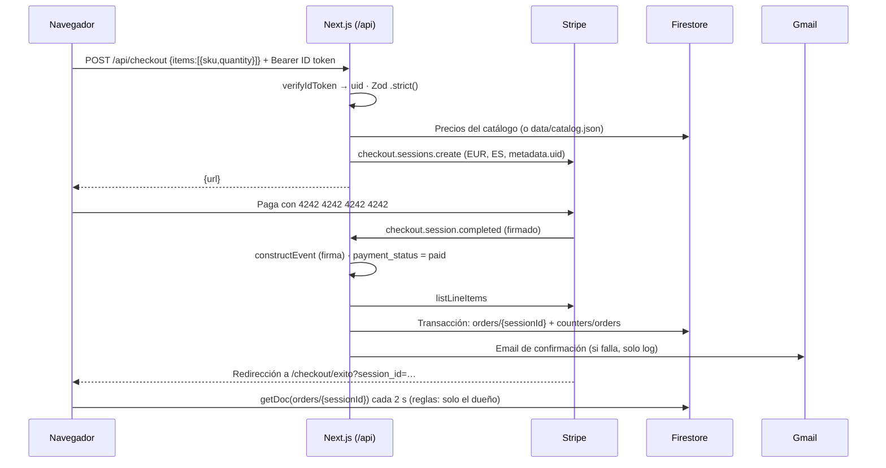

# web — Tienda Colchones Contoso (Next.js)

Tienda online de **Colchones Contoso**, marca colombiana (taller en Envigado, algodón del Tolima) que vende
colchones de adulto en España, en euros. Esta carpeta contiene la web completa y su API de tienda: catálogo,
configurador de producto, carrito, registro e inicio de sesión (correo o Google), pago con Stripe Checkout en
modo test, webhook que crea el pedido, email de confirmación, "Mis pedidos" y el widget del asistente IA,
que habla con el agente Python de [`agent/`](../agent/README.md).

## Qué hace

- **Home** con los dos colchones (Cafetal y Caribe), comparativa de núcleos, prueba de 30 noches, taller,
  opiniones de ejemplo y presentación del asistente.
- **Fichas de producto** con configurador de Medida, Núcleo y Funda: solo deja elegir combinaciones que existen,
  marca las agotadas y actualiza precio y SKU al instante.
- **Carrito** persistido en el navegador, con contador en la cabecera.
- **Cuenta**: registro e inicio de sesión con correo y contraseña o con Google (Firebase Auth).
- **Pago**: `/api/checkout` recalcula los precios en el servidor y crea una Stripe Checkout Session. El pedido
  se crea **solo** desde el webhook firmado de Stripe y se envía un email de confirmación por Gmail (SMTP).
- **Mis pedidos**: listado y detalle con línea de estados, transportista y seguimiento, leídos directamente de
  Firestore con el SDK de cliente, protegidos por las reglas de seguridad.
- **Asistente**: panel flotante con streaming SSE, indicador de consulta de herramientas y render seguro.
- **Panel de administración** (`/admin`, solo usuarios con el claim `admin`): productos (crear, editar,
  activar/desactivar, eliminar, variantes con precio y stock) y pedidos (listado, detalle, cambio de estado con
  email al cliente). La tienda no tiene datos de producto en el código: todo sale de Firestore. Ver
  [Panel de administración](#panel-de-administración).

## Stack

| Tecnología | Versión | Uso |
|---|---|---|
| Next.js (App Router) + React | 15.5 / 19.1 | Páginas, SSR/ISR y route handlers |
| TypeScript (estricto) | 5 | Todo el código |
| Tailwind CSS | 4 | Estilos, a partir de los tokens del diseño en `app/globals.css` |
| Zustand (persist) | 5 | Carrito en `localStorage` |
| Zod | 3.25 | Validación en cliente y en las API routes |
| Firebase JS SDK | 11 | Auth en el cliente y lectura de pedidos |
| firebase-admin | 13 | Verificación de ID tokens, escritura de pedidos y perfiles, lectura del catálogo |
| stripe (Node) | 18 (API `2025-08-27.basil`) | Checkout Sessions y verificación del webhook |
| Nodemailer (Gmail SMTP) + React Email | 10.0.11 / 0.5 | Email de confirmación |
| react-markdown + remark-gfm | 10 / 4 | Política de envíos y respuestas del asistente, sin HTML crudo |
| Vitest + Testing Library | 3.2 / 16 | Tests unitarios, de API y de componentes |

No se usa shadcn/ui: los pocos componentes interactivos (panel del chat, menú de cuenta, chips del
configurador) son propios y no compensaba añadir Radix.

## Estructura de carpetas

```
web/
├── app/
│   ├── layout.tsx                 # Fuentes (next/font), cabecera, pie, proveedores y ChatWidget
│   ├── globals.css                # Tokens del diseño (claro/oscuro) expuestos a Tailwind
│   ├── motion.css                 # Curvas, keyframes, microinteracciones y estados de revelado
│   ├── page.tsx                   # Home
│   ├── productos/[slug]/page.tsx  # Ficha con galería y configurador (SSG + ISR 5 min)
│   ├── carrito/page.tsx
│   ├── login/page.tsx · registro/page.tsx
│   ├── pedidos/page.tsx · pedidos/[id]/page.tsx   # Protegidas (guarda en cliente + reglas)
│   ├── checkout/exito/page.tsx    # "Procesando…" y espera a que el webhook cree el pedido
│   ├── checkout/cancelado/page.tsx
│   ├── envios-y-devoluciones/page.tsx  # Renderiza data/shipping_policy.md (o Firestore)
│   ├── not-found.tsx · error.tsx  # 404 y error controlado (p. ej. Firestore no responde)
│   ├── admin/                     # Panel: layout (noindex + guarda), resumen, productos/, pedidos/
│   └── api/
│       ├── checkout/route.ts          # POST: crea la Checkout Session
│       ├── webhooks/stripe/route.ts   # POST: crea el pedido (idempotente) y envía el email
│       ├── users/me/route.ts          # POST: upsert del perfil users/{uid}
│       ├── admin/products/…           # GET/POST y GET/PUT/PATCH/DELETE [slug] (claim admin)
│       ├── admin/orders/…             # GET (lista) y GET/PATCH [id] (claim admin)
│       ├── admin/summary/route.ts     # GET: cifras de la portada del panel
│       └── catalog/images/route.ts    # GET estático (build): fotos de public/images para el selector
├── components/
│   ├── admin/       # RequireAdmin, AdminNavLink, AdminNav, ProductsAdmin, ProductForm (+ productFormModel),
│   │                # ImageUploader (subida a Storage), ProductEditor, OrdersAdmin, OrderAdminDetail,
│   │                # AdminSummary, useAdminStatus
│   ├── auth/        # AuthProvider (contexto, Google, correo), AuthForm, RequireAuth
│   ├── cart/        # CartView, CartDrawer (mini-carrito lateral), useCheckout
│   ├── chat/        # ChatWidget, ChatMarkdown (render seguro), ChatContext
│   ├── home/        # ProductCard, Benefits, Reviews + ReviewsTrack (carrusel), CountUp, TrustBadges
│   ├── layout/      # SiteHeader (mini-carrito y cuenta), SiteFooter, Logo
│   ├── orders/      # OrdersList, OrderDetail, CheckoutSuccess, OrderStatus
│   ├── product/     # ProductConfigurator, ProductGallery, CoresTable, selection.ts (lógica pura)
│   └── ui/          # Notice, Spinner, Skeleton, Toaster, AnimatedPrice, Icons, RevealObserver
├── emails/                       # React Email: OrderConfirmation, NewOrderAlert (tienda), OrderStatusUpdate
├── lib/
│   ├── admin/       # auth.ts (requireAdmin), products.ts, productImages.ts (borrado en Storage), orders.ts,
│   │                # errors.ts (server-only); client.ts e imageUpload.ts (validación, compresión, subida) en navegador
│   ├── catalog/     # Esquemas Zod (lectura y admin-schema.ts), generador de variantes, repositorio, hosts de imagen
│   ├── cart/        # Store de Zustand y estado del mini-carrito (drawer.ts)
│   ├── motion/      # Hooks de movimiento: tween numérico, foco atrapado, prefers-reduced-motion
│   ├── ui/toast.ts  # Cola de toasts (Zustand)
│   ├── chat/client.ts   # ÚNICO módulo que conoce el contrato SSE del agente
│   ├── email/       # Interfaz EmailSender + implementación Gmail (SMTP)
│   ├── firebase/    # admin.ts (server-only) y client.ts (navegador)
│   ├── orders/      # fulfill.ts (creación del pedido), status.ts (reglas de estado, compartidas con scripts/), tipos
│   ├── checkout.ts  # Recalcula precios y construye los parámetros de Stripe
│   ├── schemas.ts   # Esquemas Zod (checkout, login, registro, IDs)
│   └── stripe.ts    # Cliente Stripe (server-only) y tarifas de envío
├── security-headers.mjs  # CSP y cabeceras (las usa next.config.ts y los tests)
├── next.config.ts
├── public/images/        # Fotos (Unsplash) y nombres que usa data/catalog.json
├── tests/                # Vitest (ver "Tests")
└── .env.example
```

**Fuente de verdad del catálogo**: con `FIREBASE_ADMIN_CREDENTIALS`, la colección `products` de Firestore, que se
gestiona desde el panel. `../data/catalog.json` es solo la **semilla inicial** (`scripts/seed.ts`) y el catálogo de
desarrollo cuando no hay credenciales. La política de envíos sigue el mismo esquema (`content/shipping_policy` o
`../data/shipping_policy.md`).

## Rutas y páginas

| Ruta | Tipo | Acceso | Descripción |
|---|---|---|---|
| `/` | Estática + ISR (5 min) | Público | Home (port del diseño aprobado) |
| `/productos/[slug]` | SSG (slugs de Firestore) + ISR, `dynamicParams` | Público | Ficha con configurador, tabla de núcleos, fundas, envío, opiniones demo y recomendado. Los productos creados después del build se generan bajo demanda |
| `/carrito` | Cliente | Público (pagar exige sesión) | Líneas, cantidades, total estimado y botón de pago |
| `/login`, `/registro` | Cliente | Público | Google arriba, separador "o con tu correo" y formulario |
| `/pedidos` | Cliente | Sesión | Mis pedidos (Firestore, `userId == uid`, `createdAt desc`) |
| `/pedidos/[id]` | Cliente | Sesión + dueño | Detalle; si no es tuyo, las reglas lo deniegan y se muestra "no encontrado" |
| `/checkout/exito?session_id=…` | Cliente | Sesión | Consulta cada 2 s (máx. ~1 min) hasta que el webhook haya creado el pedido. **No crea nada** |
| `/checkout/cancelado` | Estática | Público | Pago cancelado; el carrito se conserva |
| `/envios-y-devoluciones` | ISR | Público | Política en markdown (Firestore `content/shipping_policy` o `data/shipping_policy.md`) |
| `/admin`, `/admin/productos`, `/admin/productos/nuevo`, `/admin/productos/[slug]`, `/admin/pedidos`, `/admin/pedidos/[id]` | Cliente | Claim `admin` | Panel de administración (`noindex`) |

## API routes

Todas responden JSON con `Cache-Control: no-store`, usan runtime Node.js y devuelven mensajes genéricos en
español (el detalle solo va a los logs). Si faltan credenciales responden **503** controlado.

### `POST /api/checkout`

| | |
|---|---|
| Cabecera | `Authorization: Bearer <Firebase ID token>` (obligatoria) |
| Cuerpo | `{ "items": [{ "sku": "CAF-150190-CEI-TER", "quantity": 2 }] }` — esquema `.strict()`: cualquier campo extra (`price`, `uid`…) → 400 |
| Límites | 1–20 líneas, cantidad entera 1–10 por SKU (también sumando líneas repetidas), SKU `^[A-Z0-9-]{3,40}$` |
| 200 | `{ "url": "https://checkout.stripe.com/…" }` |
| Errores | 400 carrito no válido o SKU inexistente · 401 sin sesión/token inválido · 409 variante agotada · 502 fallo de Stripe · 503 sin configurar |

En el servidor: verifica el token con firebase-admin, valida con Zod, **recalcula los precios desde el
catálogo** (Firestore o JSON), y crea la sesión con `mode=payment`, EUR, `locale=es`,
`shipping_address_collection.allowed_countries=["ES"]`, tres tarifas de envío según la política
(península gratis, Baleares 45 €, Canarias/Ceuta/Melilla 89 €), `metadata.uid`, `client_reference_id = uid`,
`payment_intent_data.metadata.uid`, `customer_email` del token y, por línea, `product_data.metadata`
`{sku, slug, options}`.

### `POST /api/webhooks/stripe`

| | |
|---|---|
| Cabecera | `stripe-signature` (verificada con `STRIPE_WEBHOOK_SECRET` sobre el cuerpo crudo) |
| Eventos | Solo `checkout.session.completed` con `payment_status = "paid"`; el resto → 200 `{received, ignored}` |
| 200 | `{ "received": true, "result": "created" \| "duplicate" }` |
| Errores | 400 firma ausente o inválida (no se escribe nada) · 500 fallo al guardar (Stripe reintenta) · 503 sin configurar |

Tras guardar el pedido envía el email de confirmación al cliente y, aparte, el **aviso "Nuevo pedido" a la tienda**
(`ADMIN_NOTIFICATION_EMAIL`, o `GMAIL_USER` si falta) con número, total, artículos, dirección y enlace a
`/admin/pedidos/<id>`. Cada envío va en su propio `try/catch`: si falla se registra y el pedido queda guardado.

Crea `orders/{session.id}` en **una transacción** que lee el pedido (si existe, no hace nada) y el contador
`counters/orders`, y escribe ambos: así un evento repetido o concurrente no duplica el pedido ni consume
número. `orderNumber` = `CP-` + 6 dígitos. Los ítems e importes salen de Stripe
(`listLineItems` con `expand: data.price.product`), la dirección de `collected_information.shipping_details`,
y `statusHistory` empieza con `paid`. Después envía el email; si falla, se registra y el pedido queda guardado.

### `POST /api/users/me`

| | |
|---|---|
| Cabecera | `Authorization: Bearer <Firebase ID token>` |
| Cuerpo | Ninguno (se ignora): todo sale del token verificado |
| 200 | `{ "ok": true }` |
| Errores | 401 sin token o inválido · 503 sin configurar |

Hace upsert de `users/{uid}` con `email`, `displayName`, `photoURL` (solo `https://`), `provider`
(`password` o `google.com`), `updatedAt` y `createdAt` (solo la primera vez). Se llama tras el registro con
correo y tras cada acceso con Google. Existe porque las reglas no permiten escribir `users` desde el cliente.

### `/api/admin/**`

Ver [Panel de administración → API](#api-del-panel).

## Flujo de compra



## Autenticación

- `components/auth/AuthProvider.tsx` expone `user`, `loading`, `getToken()` (el SDK renueva el ID token antes de
  que caduque; se escucha `onIdTokenChanged`), `signInWithEmail`, `registerWithEmail`, `signInWithGoogle` y
  `signOut`.
- **Google**: `signInWithPopup(GoogleAuthProvider)`; si el navegador bloquea el popup
  (`auth/popup-blocked`, `operation-not-supported-in-this-environment`, `web-storage-unsupported`) se pasa a
  `signInWithRedirect` y al volver se procesa `getRedirectResult`.
- Errores en español (`lib/auth/errors.ts`): cerrar el popup no muestra nada alarmante;
  `auth/account-exists-with-different-credential` explica que ese correo ya tiene contraseña; dominio no
  autorizado; red; demasiados intentos; credenciales incorrectas (sin revelar si el correo existe).
- Tras el registro con correo o el acceso con Google se llama a `POST /api/users/me`.
- La cabecera muestra la foto de Google (o la inicial del nombre) en el botón de cuenta, con menú para ir a
  "Mis pedidos" o cerrar sesión.
- `RequireAuth` es una guarda **de cliente** (redirige a `/login?next=…`); la protección real de los datos son
  las reglas de Firestore. `next` se valida para evitar redirecciones abiertas.

### Pasos manuales en Firebase Console

1. **Authentication → Sign-in method**: habilitar *Correo electrónico/contraseña* y *Google* (elegir el email
   de asistencia del proyecto).
2. **Authentication → Settings → Authorized domains**: añadir el dominio de Vercel (`<app>.vercel.app` y el
   dominio propio si lo hay). `localhost` ya viene autorizado.
3. **Configuración del proyecto → Tus apps → App web**: copiar `apiKey`, `authDomain`, `projectId` y `appId`
   a las variables `NEXT_PUBLIC_FIREBASE_*`.
4. **Cuentas de servicio → Generar nueva clave privada**: codificarla en base64 y guardarla como
   `FIREBASE_ADMIN_CREDENTIALS` (nunca en el repositorio).
5. Desplegar reglas e índices (ver [`firebase/README.md`](../firebase/README.md)).

> El acceso por redirección (`signInWithRedirect`) depende del almacenamiento de terceros. En navegadores que lo
> bloquean (Safari, Chrome con particionado) puede no completarse si `authDomain` es `*.firebaseapp.com` y la web
> está en otro dominio. El flujo principal es el popup, que funciona en todos ellos; la solución completa del
> redirect es servir `/__/auth/*` desde el propio dominio (fuera del alcance de esta prueba).

## Carrito

- `lib/cart/store.ts`: Zustand con `persist` en `localStorage` (clave `contoso-cart`). Cada línea guarda
  `sku`, `slug`, `name`, `options`, `unitPrice`, `image` y `quantity`.
- Añadir la misma variante suma cantidades; la cantidad se acota a 1–10 por línea.
- El precio guardado es **solo informativo**: al pagar solo se envían `sku` y `quantity` y el servidor
  recalcula todo.
- Se vacía al volver de Stripe a `/checkout/exito` con un `session_id` válido. Si el pago se cancela se conserva.
- `useHydrated` evita desajustes de hidratación al leer el carrito persistido.

## Integración con el asistente

- Cliente: **`lib/chat/client.ts`** (único módulo que conoce el contrato) y UI en `components/chat/ChatWidget.tsx`.
- Petición: `POST ${NEXT_PUBLIC_AGENT_URL}/chat` con `{"messages":[{"role":"user"|"assistant","content":"…"}]}`
  (últimos 20 mensajes, sin vacíos, respuestas del asistente recortadas a 4000 caracteres) y
  `Authorization: Bearer <ID token>` solo si hay sesión.
- Respuesta SSE `event: <tipo>\ndata: <json>\n\n`, leída con `fetch` + `ReadableStream` (tolera eventos partidos
  entre chunks, también caracteres UTF-8 partidos):

| Evento | Datos | Qué hace el widget |
|---|---|---|
| `token` | `{text}` | Concatena el texto en la burbuja del turno |
| `tool_start` | `{name}` | Muestra "Buscando tus pedidos…", "Consultando el catálogo…", etc. |
| `replace` | `{text}` | Sustituye **todo** el texto del turno (filtro de salida del agente) |
| `done` | `{provider}` | Fin del turno |
| `error` | `{code, message}` | Muestra `message`; el turno termina sin `done` |

- Errores HTTP previos al stream (`{"error":{"code","message"}}`): 401 → "Tu sesión ha caducado" con enlace a
  iniciar sesión; 429 → mensaje del agente (lee `Retry-After`); 400/422 → mensaje de validación; 5xx → "no
  disponible"; error de red → "No hemos podido conectar".
- El input limita a 1000 caracteres con contador; Enter envía y Mayús+Enter hace salto de línea; se puede parar
  la respuesta.
- Render con `react-markdown` y `skipHtml` (ni `<script>` ni `` llegan al DOM), imágenes
  desactivadas y enlaces externos con `rel="noopener noreferrer nofollow"`. Los mensajes del usuario se
  pintan como texto.
- Responsive: panel de 400 px abajo a la derecha en escritorio, pantalla completa en móvil; Escape lo cierra y
  el foco vuelve al botón flotante.
- Contrato completo y códigos: [`agent/README.md`](../agent/README.md#contrato-de-chat-y-eventos-sse).

## Panel de administración

### Dar (o quitar) el rol de administrador

El rol es un **custom claim de Firebase Auth** (`admin: true`). Solo lo puede poner el Admin SDK, desde
[`scripts/set-admin.ts`](../scripts/README.md#set-admints):

```bash
cd scripts
npm run admin:set -- persona@ejemplo.com             # asigna (idempotente)
npm run admin:set -- persona@ejemplo.com --revoke    # quita el rol y revoca sus sesiones
```

La persona debe haberse registrado (o entrado con Google) antes. Después basta con **recargar `/admin`**: la guarda
pide un ID token nuevo con `getIdTokenResult(true)`, así que no hace falta cerrar sesión.

### Rutas

| Ruta | Qué se hace |
|---|---|
| `/admin` | Resumen: pedidos y facturación de hoy (hora de Madrid, sin cancelados), pendientes de preparar (y cuántos sin revisar), en preparación y enviados. Cada cifra enlaza al listado filtrado |
| `/admin/productos` | Todos los productos, **también los inactivos**: activar/desactivar, editar, ver en la tienda y eliminar con confirmación en la propia página (foco en "Cancelar", Escape cierra). Los documentos de Firestore que no cumplen el esquema se listan aparte para poder borrarlos |
| `/admin/productos/nuevo` y `/admin/productos/[slug]` | Formulario completo (ver abajo) |
| `/admin/pedidos` | Todos los pedidos, del más reciente al más antiguo, de 20 en 20 ("Cargar más"), con filtro por estado (`?estado=paid`) y búsqueda por número `CP-000123`. Distintivo **Nuevo** en los pagados que nadie ha abierto todavía |
| `/admin/pedidos/[id]` | Detalle (artículos, dirección, cliente, historial, transportista) y **cambio de estado**. Abrirlo marca `reviewedAt` |

El enlace "Panel de administración" (`components/admin/AdminNavLink.tsx`) solo se pinta para administradores; va
en el menú de cuenta de la cabecera.

### Productos

- Campos del documento `products/{slug}`: slug (validado `^[a-z0-9]+(-[a-z0-9]+)*$`, único, **inmutable** tras
  crear porque es el ID), nombre, descripción corta y larga, imágenes, opciones (Medida/Núcleo/Funda u otras, hasta 6),
  detalles de opciones (filas clave/valor por valor; los números se guardan como números: la tabla de núcleos usa
  `alturaCm`, `capas`, `garantiaAnos`…), características, variantes y activo.
- **Imágenes**: tres fuentes que se combinan en una lista ordenable con ↑/↓ (la primera es la principal):
  1. **Subir fotos** a Firebase Storage (ver abajo).
  2. Selector con las fotos de `public/images` (lista generada en el build por `/api/catalog/images`).
  3. Una ruta `/images/…` o una URL `https://` de `images.unsplash.com` o de **nuestro** bucket de Storage
     (`firebasestorage.googleapis.com/v0/b/<bucket>/o/products%2F…` o `storage.googleapis.com/<bucket>/products/…`).
     `lib/catalog/image-hosts.ts` fija el bucket (`NEXT_PUBLIC_FIREBASE_STORAGE_BUCKET` o, si falta,
     `clearpoint-colchones.firebasestorage.app`); URLs de otros buckets se rechazan en el formulario y en la API.
     Las mismas rutas están en `images.remotePatterns` (pasan por `/_next/image`).

### Subida de fotos (Firebase Storage)

Las fotos se suben **directamente desde el navegador** a `gs://clearpoint-colchones.firebasestorage.app` con el SDK
(`uploadBytesResumable` + `getDownloadURL`), así no pasan por las funciones de Vercel ni por su límite de cuerpo. La
protección son las **reglas de Storage** ([`firebase/storage.rules`](../firebase/README.md#reglas-de-storage)): solo
la cuenta `admin@contoso.example` con email verificado y `admin: true` en el token, solo en `products/<slug>/`,
menos de 5 MB y JPEG/PNG/WebP/AVIF. El email está fijado en las reglas: si cambia `ADMIN_EMAILS`, hay que editarlas
y redesplegarlas.

- En el formulario: zona de **arrastrar y soltar** y botón **Subir fotos** (varias a la vez). Componente
  `components/admin/ImageUploader.tsx`; lógica en `lib/admin/imageUpload.ts`.
- **Validación previa** (mensajes en español): tipo JPEG, PNG, WebP o AVIF; hasta 20 MB al elegir (se comprime
  después) y **menos de 5 MB lo que se sube**; máximo 12 imágenes por producto.
- **Compresión en el navegador** con `createImageBitmap` + canvas: WebP, lado mayor ≤ **1600 px**, calidad **0,82**.
  Si el navegador no puede (no decodifica el formato, sin codificador WebP…) se sube el original si cumple los
  límites; si ya era pequeño y comprimir no lo mejora, también.
- Nombre: `products/<slug>/<timestamp>-<aleatorio>.webp` (con la extensión del original si se sube sin comprimir),
  con `Cache-Control: public, max-age=31536000, immutable`.
- Por fichero: vista previa local (`blob:`), barra de progreso, **Cancelar** y error con **Descartar**. Al terminar,
  la URL de descarga se añade al final de la lista de imágenes; hay que **guardar** el producto para que quede en
  Firestore.
- **Productos nuevos**: hace falta un slug válido antes de subir (las fotos van a su carpeta). En cuanto hay una foto
  subida, el slug se bloquea; para cambiarlo hay que quitar esas fotos.
- Sin `NEXT_PUBLIC_FIREBASE_STORAGE_BUCKET` el botón se oculta con un aviso (biblioteca y URLs siguen funcionando).
- **Limpieza**: al **eliminar un producto** (`DELETE /api/admin/products/[slug]`) el servidor borra con el Admin SDK
  todo `products/<slug>/` (`getStorage().bucket().deleteFiles({prefix})`). Si Storage falla, el producto se borra igual,
  el fallo se registra (`[admin] no se pudieron borrar las fotos de Storage`) y el panel lo indica. **Quitar una foto
  del formulario no borra el fichero**, porque podría seguir referenciada hasta guardar (ver Limitaciones).
- Para que el token del navegador lleve el claim basta con recargar `/admin` tras dar el rol (la guarda pide un token
  nuevo). Un error `storage/unauthorized` suele ser falta de rol, otra cuenta o email sin verificar, o reglas sin
  desplegar.
- **Variantes**: "Generar combinaciones" crea una variante por combinación de opciones con un SKU legible
  (`CAF-150190-BRISA-ALGODO`, prefijo editable) y el precio base; conserva las existentes con su precio y stock, y
  avisa de las que ya no encajan para quitarlas. Tabla editable de SKU, precio (acepta coma decimal) y stock, y ajuste
  masivo "sumar X € a las variantes con Núcleo = Ceiba+". Renombrar una opción o un valor actualiza variantes y
  detalles.
- **Validación**: el mismo esquema Zod (`lib/catalog/admin-schema.ts`, `.strict()`) en el formulario y en la API:
  SKU `^[A-Z0-9-]{3,40}$` único en el producto y combinación única; cada variante con un valor válido por opción;
  precio 0–100 000 € con dos decimales; sin imágenes, opciones ni valores repetidos. La API comprueba además, en una
  transacción, que el slug no exista (409) y que ningún SKU lo use **otro** producto (409). `priceFrom`, `currency`,
  `updatedAt` (y `createdAt` al crear) los pone el servidor.
- Tras cada escritura se llama a `revalidatePath` de `/`, `/productos/<slug>` y `/productos/[slug]` (todas las fichas,
  por la sección "también te puede gustar"): el cambio se ve al momento.
- Un producto **desactivado o eliminado** desaparece de la home y su ficha da 404; además no se puede comprar
  (`findBySku` solo busca en activos) y una variante con `inStock: false` da 409 en el checkout. Los pedidos ya
  hechos conservan sus datos.

### Pedidos

- Transiciones (`lib/orders/status.ts`, compartido con `scripts/update-order-status.ts`): **Pagado → En preparación
  → Enviado → Entregado**, paso a paso, y **Cancelado** solo desde Pagado o En preparación. Entregado y Cancelado
  son finales. Cualquier otra → **409** en el servidor. Los nombres son siempre `STATUS_LABELS` de `lib/schemas.ts`
  (los mismos que en "Mis pedidos" y en el asistente).
- Cada cambio, en una transacción, actualiza `status` y `updatedAt` y añade `{status, at}` a `statusHistory`.
- Al pasar a **Enviado** son obligatorios transportista, número de seguimiento y fecha estimada (`AAAA-MM-DD`
  válida); si falta alguno → 400. Al pasar a Entregado sin fecha estimada se pone la de hoy.
- **Email al cliente** al pasar a Enviado (transportista, seguimiento y fecha), Entregado y Cancelado, con casilla
  "Avisar al cliente por email" para no enviarlo. Idempotente: el envío se registra en `notifiedStatuses.<estado>` y
  no se repite; además repetir un estado es una transición inválida (409, sin email). Si el email falla, el estado
  se guarda igual y el panel lo indica.
- Cancelar pide confirmación en la página y **no reembolsa** en Stripe (se hace desde el dashboard de Stripe).
- El asistente lee Firestore en cada consulta: tras cambiar el estado, *"¿Cómo va mi pedido CP-000123?"* responde
  con el estado nuevo, igual que "Mis pedidos" al recargar.

### API del panel

Todas exigen `Authorization: Bearer <ID token>`, responden `Cache-Control: no-store` y mensajes genéricos en español.

| Método y ruta | Cuerpo / parámetros | Respuestas |
|---|---|---|
| `GET /api/admin/products` | — | 200 `{products, invalid}` |
| `POST /api/admin/products` | Producto (`adminProductSchema`) | 201 · 400 `{error, fields}` · 409 slug o SKU duplicado |
| `GET /api/admin/products/[slug]` | — | 200 `{product}` · 404 |
| `PUT /api/admin/products/[slug]` | Producto completo; `slug` igual al de la URL | 200 · 400 (también si cambia el slug) · 404 · 409 SKU |
| `PATCH /api/admin/products/[slug]` | `{active: boolean}` | 200 · 400 · 404 |
| `DELETE /api/admin/products/[slug]` | — (borra también `products/<slug>/` en Storage) | 200 `{ok, slug, images: "deleted" \| "failed"}` · 404 |
| `GET /api/admin/orders` | `?status=&cursor=&limit=1–50&orderNumber=CP-000123` | 200 `{orders, nextCursor}` · 400 |
| `GET /api/admin/orders/[id]` | — (marca `reviewedAt` la primera vez) | 200 `{order}` · 404 |
| `PATCH /api/admin/orders/[id]` | `{status, carrier?, trackingNumber?, estimatedDelivery?, notifyCustomer?}` | 200 `{order, email}` · 400 · 404 · 409 transición inválida |
| `GET /api/admin/summary` | — | 200 `{today:{orders,revenue}, pendingPreparation, unreviewed, preparing, shipped}` |

`email` vale `sent`, `failed`, `skipped` (no se pidió aviso), `already_sent` o `not_applicable` (En preparación).

### Seguridad

- **Autorización siempre en servidor** (`lib/admin/auth.ts`): cada ruta verifica el ID token con firebase-admin
  **comprobando revocación** (`verifyIdToken(token, true)`) → 401 si falta, es inválido o se revocó; y exige
  `admin === true` en el token → 403 (un `"true"` en texto no vale). Sin credenciales de Admin → 503. Los accesos
  denegados y las escrituras se registran con el `uid`.
- La guarda de `/admin/**` (`RequireAdmin`) es solo experiencia de usuario: sin sesión redirige a
  `/login?next=…`, sin claim a `/`. Los datos solo llegan por la API.
- Las **reglas de Firestore no cambian**: siguen sin permitir escrituras de cliente y el claim `admin` no da ningún
  acceso extra desde el navegador (hay tests). El panel lee y escribe solo por la API con el Admin SDK.
- La única excepción es la **subida de fotos a Storage**, que va del navegador al bucket y la protegen las reglas de
  Storage (claim `admin === true`, email `admin@contoso.example` verificado, carpeta `products/<slug>/`, tamaño y
  tipo). Probadas con el emulador.
- `noindex` doble: `robots` en el metadata de `app/admin/layout.tsx` y cabecera `X-Robots-Tag` en `next.config.ts`.
- Payloads `.strict()` con límites de tamaño; IDs de pedido `cs_…` y slugs validados antes de tocar Firestore;
  URLs de imagen con lista blanca de hosts; sin `confirm()` ni HTML crudo.

### Si Firestore falla

En modo Firestore el catálogo **nunca vuelve al JSON** (un producto borrado no puede reaparecer):
`CatalogUnavailableError`. Las páginas ISR siguen sirviendo la última versión buena ya generada; una página sin
versión previa muestra `app/error.tsx` ("No hemos podido cargar esta página", con Reintentar); `/api/checkout`
responde 503; si falla durante el build, las fichas se generan bajo demanda. Cero productos o un slug inexistente
son respuestas válidas (home vacía, 404).

## Diseño

- Basado en el diseño de home aprobado: cabecera fija con barra superior, hero partido con foto en arco, franja
  wayuu como único gesto gráfico, botón flotante "¿Te ayudo?".
- **Tokens** (variables CSS en `app/globals.css`, con modo oscuro por `prefers-color-scheme` y
  `data-theme`), expuestos a Tailwind como `bg-bg`, `bg-surface`, `bg-tint`, `text-ink`, `text-muted`,
  `border-line`, `bg-aji`, `text-aji-ink`, `bg-panela`, `text-guayaba`, `text-on-accent`:

| Token | Claro | Oscuro | Uso |
|---|---|---|---|
| `--bg` arena | `#F7EEE4` | `#1B120D` | Fondo |
| `--surface` | `#FFFAF4` | `#251912` | Tarjetas |
| `--tint` panela clara | `#EFDDCB` | `#33231A` | Bloques destacados |
| `--ink` café tostado | `#2C1B12` | `#F6E9DB` | Texto |
| `--muted` | `#6E5546` | `#C2A894` | Texto secundario |
| `--line` | `#E2CDBA` | `#3F2C20` | Bordes |
| `--aji` naranja ají | `#D9542B` | `#F07043` | Acento principal, botones |
| `--aji-ink` | `#B8431F` | `#F4855D` | Ají para texto pequeño (contraste AA sobre arena) |
| `--panela` | `#C4862C` | `#E0A54A` | Foco, sellos, estrellas |
| `--guayaba` | `#C9566A` | `#E57A8C` | Uso puntual |

- **Tipografías** con `next/font/google` (autoalojadas, sin peticiones a Google en tiempo de ejecución):
  Bricolage Grotesque (display), Figtree (cuerpo) y DM Mono (datos, precios, SKU).
- **Fotos** (Unsplash), con el crédito visible junto a cada una: hero — Matthieu Lemarchal; textura — Costa
  Live; taller — Roberto Nickson; Cafetal — Deconovo; Caribe — Nathan Van Egmond.
  Los nombres `colchon-*-1/2.jpg` son los que referencia `data/catalog.json`.
- Accesibilidad: enlace "Saltar al contenido", foco visible (`outline` panela), chips del configurador como
  radios nativos con `fieldset`/`legend`, `aria-live` en precio y chat, textos alternativos, respeto de
  `prefers-reduced-motion`.

### Movimiento y microinteracciones

Todo vive en `app/motion.css` (capa `components`, sin tocar paleta ni tipografías) más unos pocos hooks en
`lib/motion/hooks.ts`. Sin dependencias nuevas: CSS (transitions/keyframes), IntersectionObserver, rAF y la
Web Animations API.

- **Base**: curvas `--ease-out` `cubic-bezier(.2,.8,.2,1)` y `--ease-spring`, duraciones de 150/220/300 ms.
  Se anima solo `transform` y `opacity` (las sombras de hover de los botones son la excepción, solo pintura;
  en tarjetas la sombra es un pseudo-elemento que cambia de opacidad).
- **Revelado al hacer scroll**: cualquier elemento con `data-reveal` (o `data-reveal="stagger"` para escalonar
  sus hijos). `RevealObserver` (en el layout) solo oculta, ya con JS, lo que está por debajo de la pantalla y
  lo muestra al entrar; lo que ya se ve no se anima. Sin JS, sin IntersectionObserver, al imprimir o con
  movimiento reducido todo queda visible. Entradas al cargar con `.enter` (hijos escalonados, CSS puro).
- **Botones**: elevación al pasar el ratón, brillo que cruza el primario, `scale(.97)` al pulsar, flecha
  (`<ArrowRight />`, clase `btn-arrow`) que se desplaza. Foco visible con un pequeño "asentamiento" animado.
- **Barra superior**: marquesina con cuatro mensajes (envío gratis, 30 noches, pago seguro con Stripe, cosido
  en Medellín); se pausa al pasar el ratón, con el foco o con su botón de pausa (WCAG 2.2.2).
- **Cabecera**: al salir de pantalla la barra superior, se compacta sin mover el contenido (`top` negativo del
  `sticky` + `translate`, sin CLS), gana sombra y logo más pequeño; subrayado animado en los enlaces; "bump"
  del contador del carrito al añadir; menú móvil con fundido, desplazamiento y enlaces escalonados (Escape lo
  cierra).
- **Hero**: titular, texto, CTA y sellos de confianza entran escalonados; foto en arco con zoom lento
  (ken burns) y sello "Hecho en Colombia" flotando.
- **Franja wayuu**: el dibujo se desplaza en horizontal de forma continua (pseudo-elemento con `transform`).
- **Beneficios**: fondo que se templa, icono que sube, gira y se rellena de ají.
- **Tarjetas de producto**: elevación con sombra, zoom de la foto, distintivo ("Más vendido" en Caribe,
  "Nuevo" en Cafetal), botón "Ver detalles" que sube sobre la foto (solo con ratón) y chips con hover.
- **Ficha**: galería con fundido entre fotos y zoom que sigue al ratón; chips con relleno animado al elegir;
  precio con interpolación numérica (`AnimatedPrice`, el valor final va en texto para lectores de pantalla);
  botón "Añadir" con estados cargando → check dibujado → reposo; sellos de confianza junto al CTA; al añadir
  se abre el **mini-carrito lateral** (`CartDrawer`: diálogo modal, foco atrapado, Escape y clic fuera
  cierran, bloquea el scroll del fondo, "Pagar"/"Inicia sesión para pagar", "Ver carrito", "Seguir mirando");
  en móvil, **barra fija de compra** con precio y botón cuando el botón principal queda por encima de la
  pantalla (se pinta en un portal y desplaza el botón del asistente).
- **Carrito**: skeleton mientras se hidrata, líneas que entran escalonadas y salen deslizándose, las demás se
  recolocan con FLIP; stepper −/+ con número que "salta"; totales interpolados; toast "eliminado" con
  **Deshacer**; estado vacío ilustrado.
- **30 noches**: contador de 0 a 30 al entrar en pantalla (en el HTML ya pone 30).
- **Opiniones**: carrusel con scroll-snap y puntos en móvil; rejilla con elevación en escritorio.
- **Asistente**: pulso suave del botón flotante la primera vez (`localStorage`), panel que se abre con
  resorte (sube desde abajo en móvil) y se cierra con animación, foco atrapado y `aria-modal`, mensajes que
  aparecen con fundido, puntos de "escribiendo" y chip animado al recibir `tool_start`.
- **Cuenta, pedidos y pago**: formularios que entran escalonados, errores que aparecen (y el campo vibra),
  botones con spinner; skeletons en listas y detalle; línea de estados del pedido que se dibuja paso a paso
  con pulso en el estado actual; check dibujado con pequeño estallido en `/checkout/exito`.
- **Toasts** (`toast({ text, action })`): región `aria-live`, máximo tres, se pausan con el ratón o el foco.
  Se usan al eliminar una línea del carrito y al cerrar sesión.
- **Movimiento reducido**: `prefers-reduced-motion` anula transiciones y animaciones; la marquesina pasa a
  texto estático, no se arman revelados, contadores ni tweens, y el botón "Añadir" salta al estado final.

## Seguridad

- **Cabeceras** (`security-headers.mjs`, aplicadas a todas las rutas): `Content-Security-Policy`,
  `X-Frame-Options: DENY`, `X-Content-Type-Options: nosniff`, `Referrer-Policy: strict-origin-when-cross-origin`,
  `Permissions-Policy`, `Cross-Origin-Opener-Policy: same-origin-allow-popups` (necesario para el popup de
  Google) y `Strict-Transport-Security` en producción.
- **CSP**:
  - `default-src 'self'`, `object-src 'none'`, `base-uri 'self'`, `frame-ancestors 'none'`.
  - `script-src 'self' 'unsafe-inline' https://apis.google.com` (+ `'unsafe-eval'` solo en desarrollo).
    `'unsafe-inline'` lo exige la hidratación de Next.js sin nonces; mejora futura: CSP con nonce en middleware.
  - `connect-src 'self'` + `identitytoolkit`, `securetoken`, `firestore`, `www.googleapis.com`,
    `apis.google.com`, `firebasestorage.googleapis.com` (subida de fotos) y el origen de `NEXT_PUBLIC_AGENT_URL`.
  - `frame-src https://accounts.google.com https://*.firebaseapp.com` + el `authDomain` configurado.
  - `img-src 'self' data: blob: https://lh3.googleusercontent.com https://firebasestorage.googleapis.com` (foto de
    perfil de Google, vista previa local `blob:` antes de subir y fotos de Storage).
  - `form-action 'self' https://checkout.stripe.com`. La redirección a Stripe es navegación de nivel
    superior (`window.location`), que la CSP no restringe.
- **Secretos**: solo en variables de servidor; los módulos que los leen importan `server-only`
  (`lib/firebase/admin.ts`, `lib/stripe.ts`, `lib/email/gmail.ts`, `lib/catalog/repository.ts`,
  `lib/content.ts`) o son route handlers. Un test recorre el código y falla si un componente cliente lee una
  variable sin `NEXT_PUBLIC_` o si una `NEXT_PUBLIC_` tiene nombre de secreto.
- **`NEXT_PUBLIC_` es la frontera**: solo la configuración web de Firebase, la clave publicable de Stripe y
  las URLs públicas.
- Precios recalculados en servidor, pedidos solo desde el webhook firmado, `uid` siempre del token verificado,
  esquemas Zod `.strict()`, IDs de pedido validados (`cs_…`), sin `dangerouslySetInnerHTML`, errores genéricos
  al usuario y logs sin tokens ni datos de tarjeta.

## Variables de entorno

Copiar `.env.example` a `.env.local`. Ninguna es obligatoria para **arrancar**: sin ellas la tienda se puede
navegar y las funciones que dependen de ellas muestran un aviso controlado.

| Variable | Tipo | Obligatoria para | Descripción |
|---|---|---|---|
| `NEXT_PUBLIC_FIREBASE_API_KEY` | Pública | Login, pedidos | Config web de Firebase |
| `NEXT_PUBLIC_FIREBASE_AUTH_DOMAIN` | Pública | Login, Google | `<proyecto>.firebaseapp.com`; también se añade a la CSP |
| `NEXT_PUBLIC_FIREBASE_PROJECT_ID` | Pública | Login, pedidos | ID del proyecto |
| `NEXT_PUBLIC_FIREBASE_APP_ID` | Pública | Login, pedidos | ID de la app web |
| `NEXT_PUBLIC_FIREBASE_STORAGE_BUCKET` | Pública | Subir fotos en el panel | `clearpoint-colchones.firebasestorage.app` (sin `gs://`). Sin ella se oculta la subida; también fija el bucket que aceptan las URLs de imagen y el que limpia el servidor (si falta, el del proyecto) |
| `NEXT_PUBLIC_STRIPE_PUBLISHABLE_KEY` | Pública | — | `pk_test_…`. Reservada: Checkout alojado no la necesita en el cliente |
| `NEXT_PUBLIC_AGENT_URL` | Pública | Asistente | URL del agente sin barra final; se añade a `connect-src` |
| `NEXT_PUBLIC_SITE_URL` | Pública | Pago, emails | URL pública (`success_url`, `cancel_url`, enlaces del email, `metadataBase`) |
| `FIREBASE_ADMIN_CREDENTIALS` | **Secreta** | Pago, webhook, `/api/users/me`, catálogo en Firestore | JSON de cuenta de servicio en base64 (o JSON plano) |
| `STRIPE_SECRET_KEY` | **Secreta** | Pago, webhook | `sk_test_…` (o *restricted key* con Checkout Sessions) |
| `STRIPE_WEBHOOK_SECRET` | **Secreta** | Webhook | `whsec_…` del endpoint o de `stripe listen` |
| `GMAIL_USER` | Config | Email | Cuenta de Gmail remitente. Sin ella el email solo se registra en logs |
| `GMAIL_APP_PASSWORD` | **Secreta** | Email | Contraseña de aplicación de esa cuenta (requiere verificación en dos pasos) |
| `EMAIL_FROM_NAME` | Config | Email | Nombre visible del remitente. Por defecto `Colchones Contoso` |
| `ADMIN_NOTIFICATION_EMAIL` | Config | Aviso de pedido nuevo | Destinatario del email "Nuevo pedido" a la tienda. Si falta, se usa `GMAIL_USER` |

## Ejecutar en local

Requisitos: Node 20+ y npm.

```bash
cd web
npm ci
cp .env.example .env.local      # opcional: rellena lo que tengas
npm run dev                     # http://localhost:3000
```

Otros comandos:

```bash
npm run build && npm start      # build de producción
npm run lint                    # ESLint (next/core-web-vitals + typescript)
npm run typecheck               # tsc --noEmit
npm test                        # Vitest
npm run test:coverage           # Vitest + cobertura (coverage/index.html)
```

Sin credenciales: home, fichas, carrito, envíos y login responden 200; el catálogo sale de
`data/catalog.json` (solo en este modo de desarrollo); el panel muestra "no disponible" y `/api/admin/**` responde 503; `/api/checkout`, `/api/webhooks/stripe` y `/api/users/me` devuelven 503 con mensaje; el
login muestra "Inicio de sesión no disponible"; el asistente avisa de que falta `NEXT_PUBLIC_AGENT_URL`.

Para datos demo (productos, política, usuarios y pedidos) ver [`scripts/README.md`](../scripts/README.md).

## Probar pagos

1. Rellena `FIREBASE_ADMIN_CREDENTIALS`, `STRIPE_SECRET_KEY` y las `NEXT_PUBLIC_FIREBASE_*`.
2. En otra terminal, con la [Stripe CLI](https://docs.stripe.com/stripe-cli):

   ```bash
   stripe login
   stripe listen --forward-to localhost:3000/api/webhooks/stripe
   ```

   Copia el `whsec_…` que imprime en `STRIPE_WEBHOOK_SECRET` y reinicia `npm run dev`.
3. Inicia sesión, añade un colchón, pulsa **Pagar con tarjeta** y usa `4242 4242 4242 4242`, cualquier fecha
   futura, cualquier CVC y una dirección española.
4. Vuelves a `/checkout/exito`, que muestra "Procesando tu pedido…" hasta que el webhook lo crea, y luego el
   número `CP-000xxx`. El pedido aparece en "Mis pedidos" y llega el email al correo de la cuenta que compra (los usuarios demo tienen correos ficticios: para verlo, compra con una cuenta real o con Google).
5. Reenviar el mismo evento (`stripe events resend evt_…`) no duplica el pedido.

## Despliegue en Vercel

1. Importar el repositorio en Vercel con **Root Directory = `web`** (framework Next.js detectado). Dejar
   activada la opción de incluir archivos fuera del Root Directory: el build importa `../data/*`.
2. **Región de funciones**: `fra1` (Fráncfort) o `cdg1` (París) en *Settings → Functions*.
3. **Variables**: todas las de la tabla, en *Production* (y *Preview* si se usa). Marcar como *Sensitive*
   `FIREBASE_ADMIN_CREDENTIALS`, `STRIPE_SECRET_KEY`, `STRIPE_WEBHOOK_SECRET` y `GMAIL_APP_PASSWORD`.
   `NEXT_PUBLIC_SITE_URL=https://<app>.vercel.app` y
   `NEXT_PUBLIC_FIREBASE_STORAGE_BUCKET=clearpoint-colchones.firebasestorage.app`. Las `NEXT_PUBLIC_*` se incrustan
   en el build: tras cambiarlas hay que redeplegar.
4. **Webhook de Stripe** (modo test): *Developers → Webhooks → Add endpoint*
   `https://<app>.vercel.app/api/webhooks/stripe`, evento `checkout.session.completed`. Copiar su
   *Signing secret* en `STRIPE_WEBHOOK_SECRET` y redeplegar.
5. **Firebase**: añadir `<app>.vercel.app` a *Authorized domains* y desplegar reglas e índices (incluye el índice
   `orders (status, createdAt)` del filtro del panel) y las **reglas de Storage**
   (`cd firebase && npx firebase deploy --only storage --project clearpoint-colchones`). Dar el rol de administrador
   con `scripts/set-admin.ts`.
6. **Agente**: incluir `https://<app>.vercel.app` en `ALLOWED_ORIGINS` del agente.
7. Activar *Deployment Protection* en previews.

## Tests

```bash
npm test                 # 302 tests, sin red ni credenciales reales
npm run test:coverage    # informe en coverage/
```

firebase-admin (también Storage: `deleteFiles`), el SDK de Firebase Storage del navegador, Stripe (excepto la verificación de firma, que usa la librería real con un secreto de prueba),
Nodemailer y `fetch` están simulados; Firestore se sustituye por un doble en memoria con transacciones
serializadas, consultas (`where`, `orderBy`, `startAfter`, `limit`, `count`) y fallos simulados
(`tests/helpers/fakeFirestore.ts`).

| Grupo | Fichero | Qué cubre |
|---|---|---|
| Checkout | `tests/api/checkout.test.ts`, `checkout-unconfigured.test.ts` | 401 sin token o con token inválido; Zod rechaza SKU inexistente, cantidades ≤0, no enteras, enormes o en texto, campos extra (`price`, `uid`), carrito vacío, SKU con inyección, suma >10 de líneas repetidas; 409 agotado; precios SIEMPRE del catálogo (céntimos); `metadata.uid`/`client_reference_id` del token; solo ES; agrupación de SKUs; 502 sin filtrar el error de Stripe; 503 sin credenciales |
| Webhook | `tests/api/webhook.test.ts` | Firma inválida, ausente o cuerpo alterado → 400 sin escribir; otros eventos y `payment_status ≠ paid` ignorados; pedido completo (ítems, dirección, `statusHistory`); idempotencia con reenvíos y concurrencia (un solo pedido, contador sin saltos, un solo email); `CP-000123` → `CP-000124`; el email falla y el pedido se guarda; fallo de Firestore → 500; sin secreto → 503 |
| `/api/users/me` | `tests/api/users-me.test.ts` | 401 sin token o inválido; solo escribe `users/{uid del token}` aunque el cuerpo diga otra cosa; `createdAt` no cambia en accesos posteriores |
| Catálogo y configurador | `tests/unit/catalog.test.ts` | Esquema y SKUs únicos de `data/catalog.json`; resolución de variante por opciones; solo combinaciones existentes (salto a la más parecida, valores inexistentes, agotados); "desde"; subtotal en servidor |
| Carrito | `tests/unit/cart.test.ts` | Añadir, fusionar misma variante, cambiar cantidad, límites 1–10, eliminar, vaciar, total sin errores de coma flotante, persistencia y rehidratación |
| Cliente SSE | `tests/unit/chat-client.test.ts` | Los 5 eventos (incluido `replace`); eventos troceados byte a byte; CRLF; JSON roto; `Authorization` solo con sesión; últimos 20 mensajes; 400/401/422/429 (`Retry-After`)/500/503, red y sin configurar |
| Render del chat | `tests/components/chat-markdown.test.tsx`, `chat-widget.test.tsx` | `<script>` y `` no llegan al DOM; `javascript:` neutralizado; markdown normal; widget: tokens en vivo, `replace` sustituye el texto, 401 ofrece login, 429 y `error` muestran el mensaje, contador de 1000 caracteres, HTML del usuario como texto |
| Cabeceras y entorno | `tests/security/headers-and-env.test.ts` | `next.config` expone CSP, X-Frame-Options, X-Content-Type-Options y Referrer-Policy; orígenes de Firebase/Google/agente en la CSP; Storage solo en `connect-src`/`img-src` y `blob:` solo en `img-src`; `'unsafe-eval'` solo en dev; `.env.example` sin valores; ninguna `NEXT_PUBLIC_` con nombre de secreto (en `.env.example` y en el código); secretos solo en módulos `server-only`/route handlers; clientes solo leen `NEXT_PUBLIC_`; sin `dangerouslySetInnerHTML` |
| Varios | `tests/unit/misc.test.ts` | Mensajes de error de Auth en español; `next` seguro (sin redirecciones abiertas); formato de precios/fechas; `verifyBearer` (cabeceras mal formadas, token rechazado); `EmailSender` (log sin credenciales, Gmail por SMTP seguro con destinatario y remitente correctos, propagación de errores y pedido sin email) |
| Panel: productos | `tests/api/admin-products.test.ts` | Sin token 401 y sin claim 403 (también `admin: "true"`) en todas las rutas, sin escribir; `checkRevoked`; 503 sin configurar; lista con inactivos e inválidos; crear con `priceFrom`/fechas de servidor y `revalidatePath`; slug duplicado 409; SKU de otro producto 409; SKU repetido 400; 13 payloads inválidos 400 (slug, imágenes `javascript:`/`..`/otro host, campos extra, precios, opciones); PUT conserva `createdAt`, slug inmutable, 404, 409; PATCH `{active}`; DELETE y 404; DELETE borra `products/<slug>/` en Storage, un fallo de Storage no impide el borrado (se registra) y 404/slug inválido no tocan Storage; 500 sin filtrar detalles |
| Panel: pedidos | `tests/api/admin-orders.test.ts` | 401/403 (también el dueño del pedido sin claim); orden por fecha, filtro, paginación con cursor, búsqueda, filtros no válidos; `reviewedAt` idempotente; transiciones válidas e inválidas (8 casos, 409 sin escribir); shipped exige los tres datos y fecha real; email al cliente una sola vez, `notifyCustomer: false`, `already_sent`, fallo de email sin deshacer el estado; resumen (medianoche de Madrid en verano/invierno, facturación sin cancelados) |
| Panel: lógica | `tests/unit/admin-logic.test.ts` | Ida y vuelta formulario ↔ esquema con el producto semilla; lista blanca de imágenes; duplicados; decimales; generador de variantes (conserva, añade, huérfanas, colisiones de SKU); renombrar opciones/valores; reglas de estado y nombres compartidos con `lib/schemas` |
| Subida de fotos: lógica | `tests/unit/image-upload.test.ts` | Tipos admitidos y rechazados (SVG, GIF, HEIC…), vacío, 20 MB al elegir y < 5 MB al subir; nombre `products/<slug>/<timestamp>-<aleatorio>.webp` y slugs no válidos (`..`, mayúsculas…); escalado a 1600 px; compresión WebP 0,82 (convertToBlob/toBlob) y caídas al original (sin canvas, sin WebP, formato no decodificable, no mejora); original > 5 MB sin compresión → error; mensajes de Storage sin detalles internos; solo URLs del bucket configurado (`gs://` admitido, valores raros ignorados, `..`); `remotePatterns` limitados al bucket |
| Subida de fotos: componente | `tests/components/image-uploader.test.tsx` | SDK de Storage simulado: sin bucket se oculta con aviso; sin slug válido no sube; ruta y metadatos, vista previa, progreso (45 %), URL añadida al terminar; varias a la vez al soltar; error `storage/unauthorized` en español; Cancelar; validación de tipo/tamaño antes de subir; máximo 12 |
| Panel: guarda | `tests/components/require-admin.test.tsx` | Sin sesión → login con `next`; sin claim → inicio; con claim → `getIdTokenResult(true)` y panel; enlace visible solo para admins |
| Emails del panel | `tests/unit/admin-emails.test.ts`, `tests/api/webhook.test.ts` | Aviso a la tienda (destinatario, `GMAIL_USER` por defecto, contenido y enlace al panel, opciones ordenadas); emails de Enviado/Entregado/Cancelado; webhook: aviso una sola vez, su fallo no bloquea el pedido ni el email al cliente |
| Catálogo en Firestore | `tests/unit/catalog-firestore.test.ts` | Sin fallback al JSON: cero productos → `[]`, borrado → `null`, fallo → `CatalogUnavailableError`; solo activos; checkout con precio de Firestore, inactivo 400, sin stock 409 |

Las reglas de Firestore y de Storage se prueban aparte con los emuladores: ver [`firebase/README.md`](../firebase/README.md).

## Solución de problemas

| Síntoma | Causa probable |
|---|---|
| "Inicio de sesión no disponible" | Faltan `NEXT_PUBLIC_FIREBASE_*` (hay que reiniciar `npm run dev` o redeplegar) |
| `auth/unauthorized-domain` al usar Google | El dominio no está en *Authorized domains* de Firebase |
| `auth/operation-not-allowed` | Proveedor Google o correo no habilitado en Firebase |
| El popup de Google se abre y se cierra sin iniciar sesión | COOP/CSP modificados; comprobar `Cross-Origin-Opener-Policy: same-origin-allow-popups` y `frame-src` |
| "El pago no está disponible" (503) | Faltan `STRIPE_SECRET_KEY` o `FIREBASE_ADMIN_CREDENTIALS` |
| `/checkout/exito` se queda en "Procesando…" | El webhook no llega: `stripe listen` parado, `STRIPE_WEBHOOK_SECRET` distinto o endpoint mal configurado (ver logs `[webhook]`) |
| Webhook 400 "invalid signature" | Secreto de otro endpoint o de otra sesión de `stripe listen` |
| "Mis pedidos" da error y la consola menciona un índice | Falta el índice `orders (userId ASC, createdAt DESC)`: `firebase deploy --only firestore:indexes` |
| El asistente: "No hemos podido conectar" | `NEXT_PUBLIC_AGENT_URL` incorrecta, agente caído o el origen no está en `ALLOWED_ORIGINS` (CORS) |
| No llega el email | Falta `GMAIL_USER`/`GMAIL_APP_PASSWORD`, la contraseña de aplicación es inválida o el comprador usa un correo ficticio (usuarios demo); ver logs `[email]`/`[webhook]` y la carpeta de spam |

## Limitaciones

- **Email por Gmail**: el remitente es una cuenta personal de Gmail (límite de unos 500 envíos al día) y puede
  acabar en spam. En producción real se usaría un proveedor transaccional con dominio propio (SPF/DKIM).
- La tarifa de envío la elige el cliente en Stripe Checkout; no se valida contra el código postal
  (Baleares/Canarias). Mejora: crear la sesión en dos pasos o validar en el webhook.
- CSP con `'unsafe-inline'` en scripts (limitación de Next.js sin nonces).
- Las guardas de ruta son de cliente; la protección de datos está en las reglas de Firestore y en la API.
- Panel: sin historial de cambios de productos ni roles más finos que `admin`, sin reembolsos desde el panel y sin
  edición de pedidos más allá del estado. El selector de `public/images` se genera en el build (una foto nueva ahí
  exige redeplegar; para eso está la subida a Storage).
- **Fotos huérfanas en Storage**: solo se borran al eliminar el producto. Quedan ficheros sin usar si se quita una foto
  del formulario, si se sube a un producto nuevo y no se llega a crear, o si falla la limpieza al eliminar. No hay
  limpieza automática; se pueden borrar a mano en *Storage* (o con un script futuro que compare `products/*/` con
  las URLs guardadas en Firestore).
- Las fotos se comprimen en el navegador del administrador; en navegadores sin codificador WebP se sube el original
  (si pesa menos de 5 MB). No se generan varios tamaños: `next/image` ya los sirve optimizados.
- Borrar un producto es definitivo (no hay papelera); desactivarlo es la opción reversible.
- Sin gestión de stock real (`inStock` es un dato del catálogo) ni cálculo de impuestos por región.
- Las opiniones de la home y las fichas son de ejemplo y están marcadas como tales.
- Los colchones "A medida" no piden las medidas exactas en la web; se acuerdan después por email.
